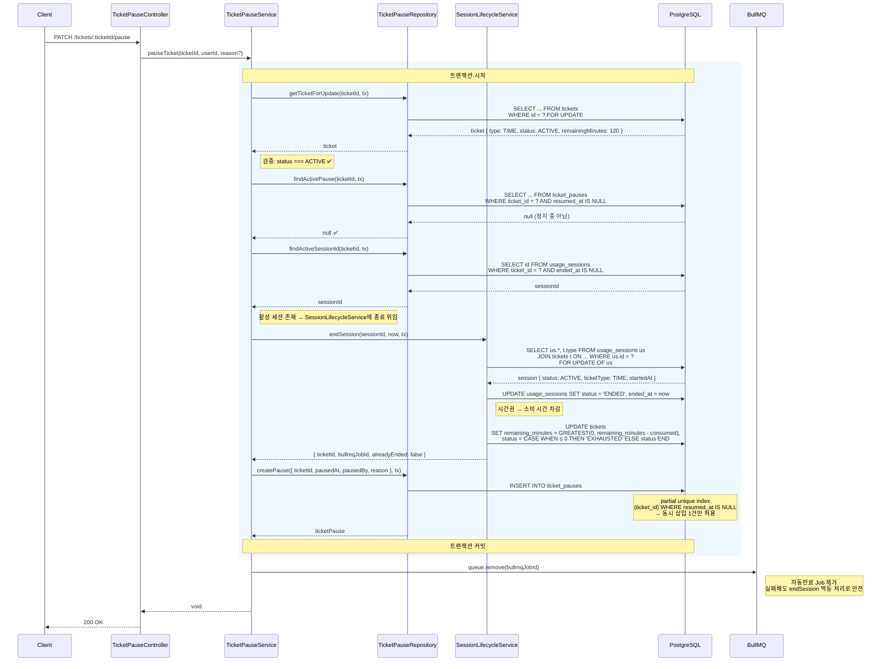
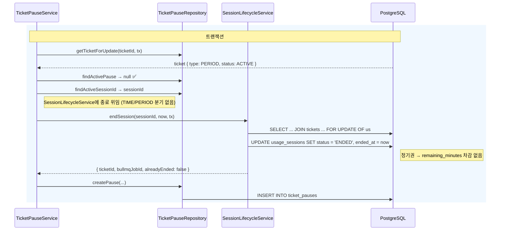
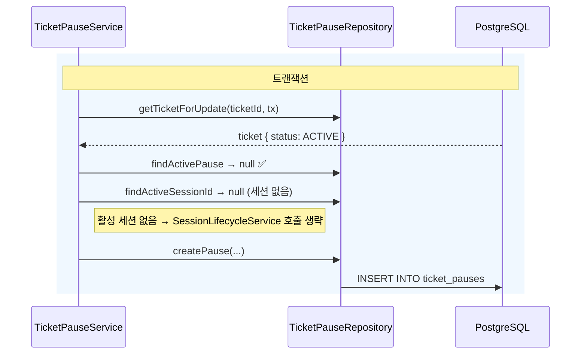
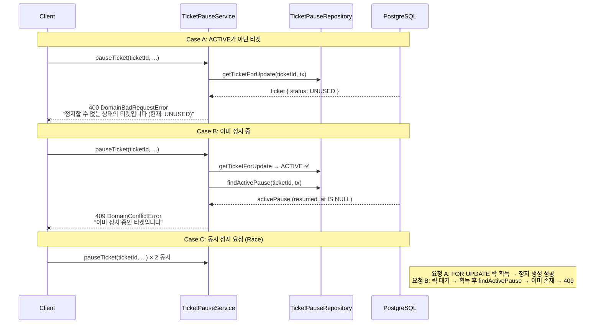
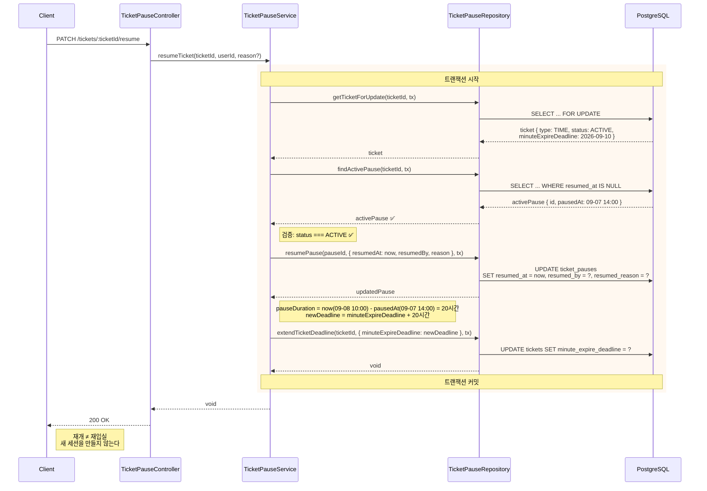
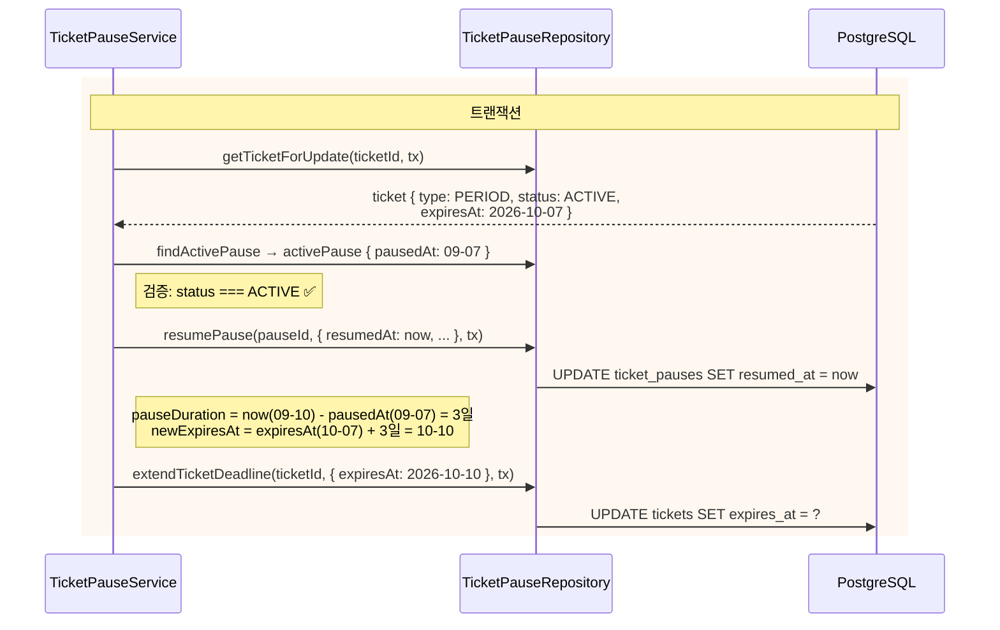
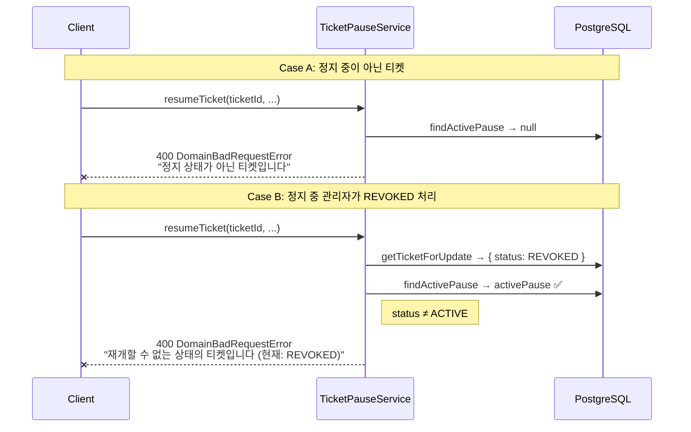
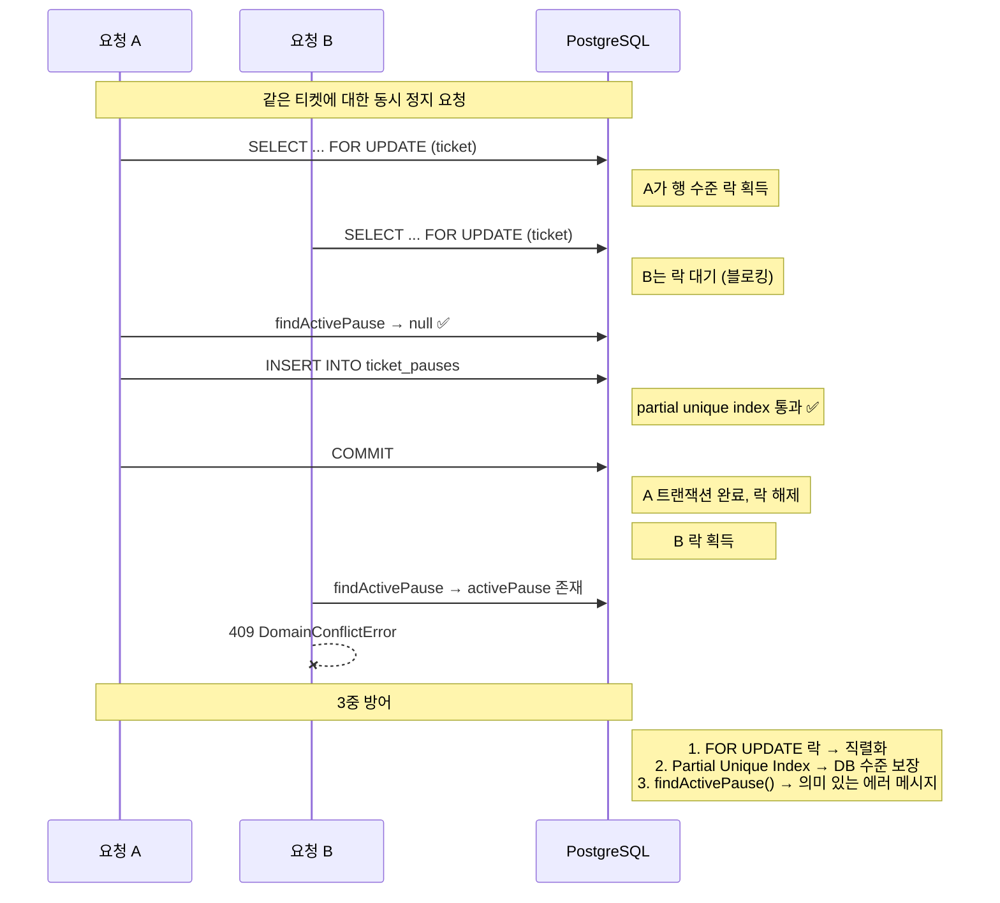
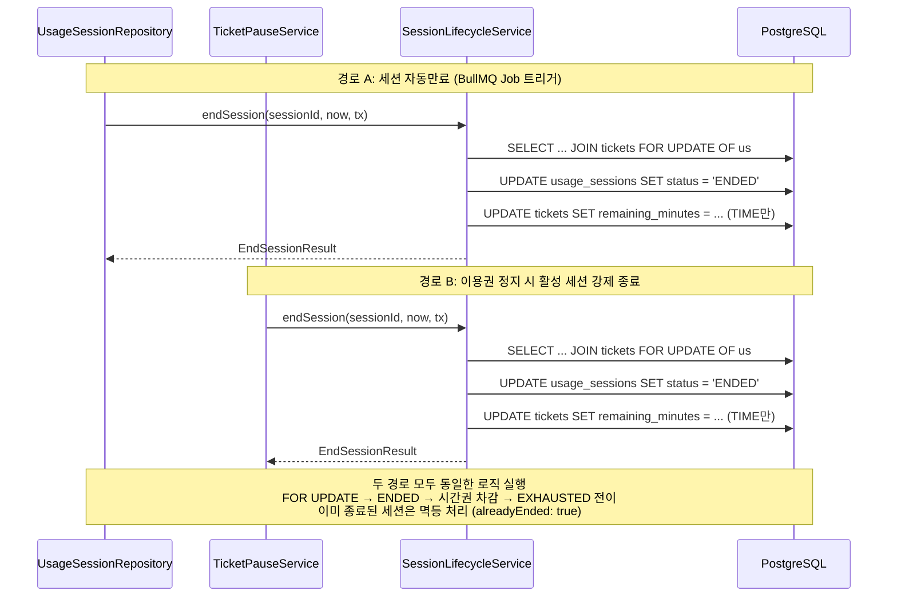

> **환불 확정 이용권과 일반 정지 구분(2026-10-26).** 아래 시퀀스는 기존 일반 정지·재개 설명이다. [환불 v0.3](../../specs/002-refund-completion/spec.md)은 이용을 종료하며, PG 실패 시 정지를 재개하거나 기한을 연장하지 않는다. 새 설계에서는 TicketPause.closedAt/closeReason으로 환불 종료를 기록하고, 활성 정지 조회는 resumedAt·closedAt이 모두 null인지 검사한다. 구현 예정 상세는 [데이터 모델](../../specs/002-refund-completion/data-model.md)을 따른다.

# 이용권 정지/재개 시퀀스

## 아키텍처 개요

세션 종료 로직은 `SessionLifecycleService`가 단일 원천(SSoT)으로 관리한다.
`TicketPauseService`와 `UsageSessionRepository` 모두 이 서비스에 위임하여 FOR UPDATE 락 → ENDED 전이 → 시간권 잔여시간 차감 → EXHAUSTED 자동 전이를 일관되게 처리한다.

```
UsageSessionModule ──→ SessionLifecycleModule
TicketModule ──────→ SessionLifecycleModule
UsageSessionModule ──→ TicketModule (기존)
```

---

## 1. 정지 (pauseTicket)

### 1-1. 시간권 정지 — 활성 세션 있는 경우

가장 복잡한 경로. 활성 세션 종료(SessionLifecycleService 위임) → TicketPause 생성 → BullMQ Job 제거.



### 1-2. 정기권 정지 — 활성 세션 있는 경우

SessionLifecycleService가 ticketType을 내부적으로 판별하므로 서비스 호출 방식은 시간권과 동일하다. 차이는 DB 내부에서 remaining_minutes 차감이 발생하지 않는다는 점.



### 1-3. 정지 — 활성 세션 없는 경우

세션 종료 단계를 건너뛴다. BullMQ Job 제거도 불필요.



### 1-4. 정지 실패 케이스



---

## 2. 재개 (resumeTicket)

### 2-1. 시간권 재개

정지 기간만큼 `minuteExpireDeadline`을 연장한다.



### 2-2. 정기권 재개

정지 기간만큼 `expiresAt`을 연장한다.



### 2-3. 재개 실패 케이스



---

## 3. 동시성 방어 구조



---

## 4. 세션 종료 위임 구조 (SessionLifecycleService)

세션 종료가 필요한 두 모듈이 동일한 서비스에 위임하는 구조.


