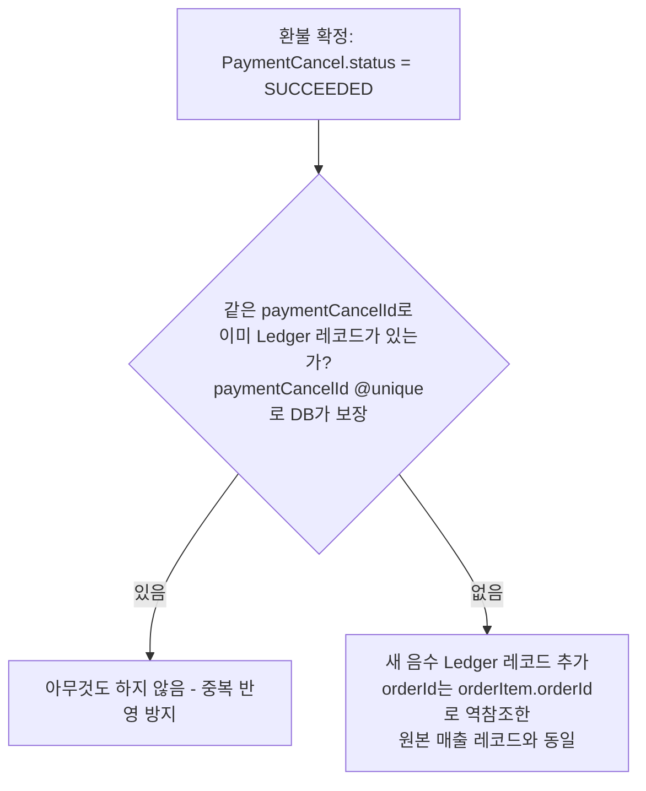

# 정산 정책 문서

## 요약

- **원장**: 매출/환불 모두 `Ledger`에 "사실 1건 = 레코드 1건"으로
  쌓는 append-only 모델. 환불은 기존 레코드를 고치지 않고 새 음수
  레코드를 추가한다(§2).
- **배치/조회 분리**: 정산 배치는 미마감 레코드를 모아 `SETTLED`로
  확정하는 것까지만 하고, 대시보드는 그때그때 `SUM`으로 즉석 계산한다
  (§3).
- **환불 반영 시점**: `PaymentCancel.status = SUCCEEDED` 확정 시점
  하나뿐이며, 환불 동시 진행 방지 트랜잭션에 묶여 삽입된다(§4).
- **이월**: 매장의 정산 예정액이 음수가 되면 해당 레코드를 마감하지
  않고 다음 배치로 이월한다(§6).
- **매장 송금(Payout)**: 장부 확정과 실제 송금은 분리된 단계다.
  관리자가 완료된 배치를 확인한 뒤 수동으로 송금을 트리거하며, 은행
  API 연동 전까지는 스텁으로 동작한다(§7).

---

이 문서는 매장에 매출을 지급하는 **정산(Ledger)** 자체의 설계를
다룬다 — append-only 원장 모델, 정산 배치와 조회의 분리, 배치
실행 이력 추적처럼 **환불이 없어도 성립하는 정산 시스템 고유의
아키텍처**가 범위다.

환불이 정산에 미치는 영향(환불 확정 시 어떤 신호를 보내는가, 언제
반영하는가)은 [환불_정책.md §5](./환불_정책.md#5-정산ledger-연동)가
다루고, 이 문서를 참조한다 — 두 문서의 역할은 "환불이 정산을
트리거하는 지점"(환불 정책)과 "정산 시스템 자체가 그 신호를 어떻게
처리하는가"(이 문서)로 나뉜다.

> **구현 상태 (2026-10-10 기준)**: 스키마는 `prisma/schema.prisma`에
> 반영되고 마이그레이션도 적용됐다. 서비스 로직(정산 배치 자동
> 실행, 대시보드 조회 쿼리)은 미구현 — 현재 `src/ledger/`에는
> `settle()`(단건 `RELEASABLE → SETTLED` 전이)과 매장 대시보드
> 조회만 있고, 이 문서가 정의하는 append-only 갱신·배치 추적
> 로직은 아직 없다. 매장 송금(`src/payout/`)은 §7에서 다루는
> 수동 트리거 구조만 있고, 실제 은행 API 연동은 스텁(`PayoutService`)
> 상태다 — PG와 마찬가지로 아직 실제 가입 전이기 때문이다.

---

## 1. 정산 단위와 상태

`Ledger`는 매장 정산 단위(`shopId`, `orderId`)로 존재하며, 상태는
`HELD → RELEASABLE → SETTLED`로 전이한다(`prisma/schema.prisma`).
`shopId`는 `Shop`을 가리키는 FK다.

> **상태 레이블 매핑**
>
> | 내부 상태(`LedgerStatus`) | 점주 표시 레이블 | 의미 |
> |---|---|---|
> | `HELD` | 정산 대기 | 지급 가능 조건 미충족, 다음 배치 대상 아님 |
> | `RELEASABLE` | 정산 예정 | 다음 정산 배치에 포함될 예정 |
> | `SETTLED` | 정산 완료 | 지급 완료 |

## 2. 설계: 환불도 하나의 원장 레코드다

**핵심 아이디어는 "UPDATE 대신 INSERT"다.** 환불이 발생해도 기존
`Ledger` 레코드(매출 1건)를 수정하지 않는다. 대신 그 환불 자체를
**새로운 음수 `Ledger` 레코드**로 추가한다. 매출도, 환불도 모두 같은
테이블에 "거래 사실 1건 = 레코드 1건"으로 쌓이는 불변(append-only)
원장이 된다 — Stripe의 `Balance Transaction`이 같은 패턴을 쓴다.

```
정산 예정액(특정 Order) = SUM(Ledger.amount WHERE orderId = X AND status != SETTLED)
```

**`orderId`를 정산 단위로 쓰는 이유**: 결제(매출의 원천)는 `Order`
단위로 이루어지는 반면([환불_정책.md §0](./환불_정책.md#0-환불의-시작점--order-orderitem-ticket)
참고), 환불은 `OrderItem` 단위로 발생한다(`PaymentCancel.orderItemId`).
매출 레코드는 `Order` 전체 금액을 그대로 쓰면 되고, 환불 레코드는
`orderItem.orderId`로 소속 `Order`를 역참조해 같은 `orderId`에 담으면
된다 — 그러면 `SUM`이 "이 주문에 대해 최종 지급할 금액"을 정확히
계산해낸다.

**`status != SETTLED` 조건이 반드시 있어야 하는 이유**: 같은 주문
안에서도 레코드별로 정산 시점이 다를 수 있다 — 예를 들어 매출 레코드가
먼저 생겨 정산 배치로 `SETTLED`(지급 완료)된 뒤에, 그 주문의 상품 중
하나만 나중에 환불돼 새 음수 레코드가 추가되는 경우다. 이때 `status`
조건 없이 그 주문의 모든 레코드를 단순 합산하면, 이미 지급이 끝난
매출과 아직 반영 안 된 환불이 뒤섞여 의미 없는 숫자가 나온다(§4
참고 — 정산 배치는 SETTLED 여부로만 미마감 레코드를 가려낸다). 원본
매출(+)과 환불(-)이 같은 공식으로 자연스럽게 상계되는 건 **"아직
마감되지 않은 레코드"라는 공통 조건을 만족하는 것들 사이에서만**
성립한다. 그래서 "지금 얼마를 정산해야 하는가"는 **그 시점에 쌓인
미마감 레코드를 더하기만 하면** 항상 정확하게 나온다. 사전에 미리
깎아둔 숫자를 따로 관리할 필요가 없다.

## 3. 정산 "배치"와 "조회"를 분리한다

**정산 배치(실제 지급)**: 정해진 시점에 해당 매장의 미마감 `Ledger`
레코드를 모아 지급액을 확정하는 작업. 지급이 확정되면 `SETTLED`
상태로 전이하며, 이후 되돌리지 않는다.

**정산 예정액 조회(대시보드)**: 화면을 조회할 때마다 `SETTLED`가
아닌 `Ledger` 레코드의 금액을 합산해 현재 정산 예정액을 보여준다.
매번 최신 데이터를 기준으로 계산하므로 미리 금액을 갱신해 둘 필요가
없다.

따라서 환불 확정 시에는 `Ledger`에 환불 레코드만 추가하면 된다.
정산 배치가 실행될 때 그 시점까지 쌓인 레코드를 집계해 최종 지급액을
확정한다.

**정산 배치가 하는 일은 장부를 확정하는 것까지다.** 확정된 금액을
매장 계좌로 실제로 보내는 것(송금)은 별도 단계이며, §7에서 다룬다.

## 4. 언제, 무엇을 추가하는가

환불이 `Ledger`에 영향을 주는 시점은 `PaymentCancel.status`가
`SUCCEEDED`로 확정되는 순간(PG가 취소를 확정한 시점) 하나뿐이다.
`REQUESTED`(PG 응답 대기) 상태에서는 아직 실제로 돈이 나간 게
아니므로 원장에 아무것도 추가하지 않는다. 이 트리거 지점에 대한
배경은 [환불_정책.md §5](./환불_정책.md#5-정산ledger-연동) 참고.



이 삽입은 [환불 동시 진행 방지 프로세스 §3](./환불_동시_진행_방지_프로세스.md#3-확정-처리)의
"확정 처리" 트랜잭션에 자연스럽게 추가된다 — `PaymentCancel` 상태
갱신, `RefundLock` 삭제, 신규 `Ledger` 레코드 삽입을 **같은
트랜잭션**으로 묶어야 세 상태가 서로 어긋나지 않는다.

## 5. 스키마

`prisma/schema.prisma`에 반영된 구조:

- `Ledger.paymentCancelId`(nullable, `@unique` FK → `PaymentCancel`) —
  매출 레코드는 `null`, 환불 레코드는 해당 `PaymentCancel.id`.
  `@unique`가 "같은 환불에 대해 레코드를 두 번 추가하지 않는다"는
  멱등성을 DB 레벨에서 보장한다.
- `Ledger.orderId`(FK → `Order`) — 정산 단위(§2 참고). 인덱스는
  `(orderId, status)`.
- `Ledger.settlementBatchId`(nullable FK → `SettlementBatch`),
  `SettlementBatch` 모델 — 배치 1회 실행의 시작/종료 시각, 상태
  (`IN_PROGRESS`/`COMPLETED`/`FAILED`), 집계 요약(`totalAmount`,
  `sellerCount`, `ledgerCount`)을 기록한다. `Ledger` row 개별로는
  "무엇이 지급됐는지"만 알 수 있고 "언제, 얼마를, 어떤 배치가"
  처리했는지는 알 수 없어서 별도 테이블로 분리했다.
- `LedgerStatus`는 `HELD`/`RELEASABLE`/`SETTLED` 세 가지만 사용한다
  (`CLAWBACK_PENDING`은 두지 않는다 — 마감 후 환불도 §2의 음수
  레코드 추가로 동일하게 처리되어 별도 상태가 필요 없다).

## 6. 음수 정산 예정액(이월) 처리

회수 대상 금액이 해당 주기의 매출보다 커서 매장의 정산 예정액이
음수가 되는 경우, **다음 정산 주기로 이월한다.**

정산 배치는 매장별로 미마감 레코드의 합계를 먼저 계산한다. 합계가
음수인 매장은 이번 배치에서 **지급액을 0으로 처리하고, 해당
레코드들을 `SETTLED`로 전이시키지 않은 채 그대로 둔다.** 다음
배치가 돌 때 그 사이 쌓인 새 매출과 자연히 합산되어 상계된다.

별도의 역청구 플로우는 두지 않는다 — 마감(`SETTLED`)은 "지급
완료"를 의미하므로, 음수 상태로 마감하면 "지급 완료로 기록됐지만
실제 지급은 없었다"는 모순이 생긴다. 미마감 유지가 `SETTLED`의
의미(§1 상태 레이블 매핑)와 일치하는 유일한 처리 방식이다.

## 7. 매장 송금(Payout)

정산 배치가 `Ledger`를 `SETTLED`로 확정하는 것과, 그 금액을 매장
계좌로 실제로 보내는 것은 서로 다른 단계다. 둘을 분리하는 이유:

- **실패 유형이 다르다** — 장부 확정은 우리 DB 안에서 끝나는 트랜잭션이지만,
  송금은 계좌번호 오류·은행 API 장애·일일 송금 한도 같은 외부 요인으로
  실패할 수 있다. 둘을 묶으면 "장부는 확정됐는데 송금은 실패"했을 때
  트랜잭션 전체를 롤백해야 하는 꼬인 상황이 생긴다.
- **검증 시간이 필요하다** — 장부 확정 직후 바로 송금하지 않고, 관리자가
  확정된 배치를 확인한 뒤 송금을 수동으로 트리거한다. 특히 실제 PG/은행
  가입 전인 지금 단계에서는 이 확인 단계가 안전장치 역할을 한다.

### 흐름

```
정산 배치 완료 (SettlementBatch.status = COMPLETED, Ledger.status = SETTLED)
        ↓ (관리자가 확인 후 API 호출)
POST /payouts { settlementBatchId, shopId, requestedBy }
        ↓
Payout 생성(PENDING) → PROCESSING → 은행 API 호출 → SUCCEEDED / FAILED
```

- 송금 금액은 그 배치에서 해당 매장으로 귀속된 `SETTLED` `Ledger`
  합계(`SUM(amount) WHERE settlementBatchId = X AND shopId = Y`)로 계산한다.
- 매장의 정산 수취 계좌 정보는 `ShopSettlementAccount`(Shop 1:1)에
  보관한다. 계좌가 없으면 송금을 트리거할 수 없다.
- 실패한 송금은 같은 `Payout` 레코드를 재사용하지 않고 새로 생성한다
  (append-only 원장과 동일한 이유 — 시도 이력을 보존한다).

### 구현 상태

`PgService`(`src/pg/pg.service.ts`)와 동일한 패턴으로 스텁을 구성했다
— 실제 은행 API를 호출하는 지점(`PayoutService.requestTransfer()`)만
비워두고, 그 전후 로직(호출 지점, Payout 상태 전이, 트랜잭션 로깅)은
이미 완성된 상태다. 실제 은행/오픈뱅킹 가입 후에는 `requestTransfer()`
내부의 `TODO`만 실제 API 호출로 교체하면 된다.

- `src/payout/payout.service.ts` — 은행 API 호출 스텁
- `src/payout/command/payout-command.service.ts` — Payout 생성·상태
  전이, 배치/계좌/금액 검증
- `src/payout/payout.controller.ts` — 관리자 수동 트리거 엔드포인트
  (`POST /payouts`)

## 8. 참고

- 스키마: `prisma/schema.prisma`의 `Ledger`, `SettlementBatch`,
  `Payout`, `ShopSettlementAccount`, `LedgerStatus`,
  `SettlementBatchStatus`, `PayoutStatus`
- 환불이 정산에 미치는 영향: [환불_정책.md §5](./환불_정책.md#5-정산ledger-연동)
- 관련 코드: `src/ledger/command/ledger-command.service.ts`,
  `src/ledger/query/ledger-query.service.ts`,
  `src/payout/command/payout-command.service.ts`,
  `src/payout/payout.service.ts`
