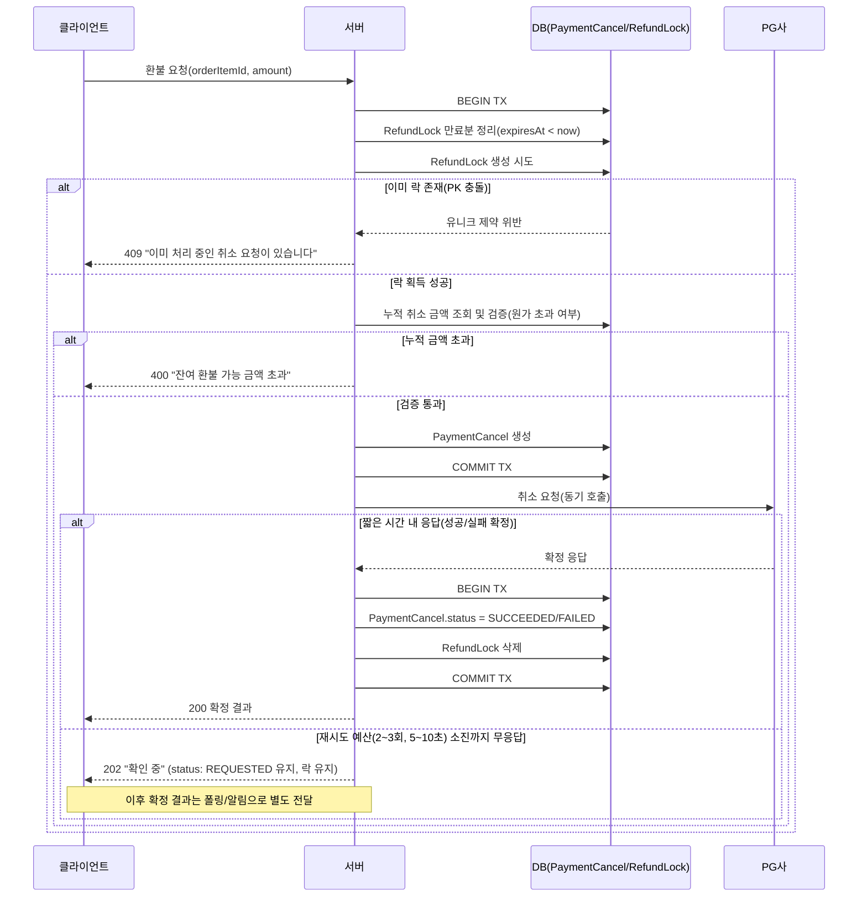

> **과거 설계 이력 — v0.3의 구현 기준은 별도 문서입니다.**
>
> 2026-10-26부터 환불 확정 시 이용 종료·좌석 해제를 먼저 처리하고 지급을 분리합니다. PG 실패로 이용권을 복구하지 않습니다. 이 문서의 승인 대기·PG 성공 시 소멸·RefundLock 신규 사용 설명은 당시 설계 기록입니다. 현재 기준은 [002 기능 명세](../../specs/002-refund-completion/spec.md)와 [데이터 모델](../../specs/002-refund-completion/data-model.md)입니다. 소스가 새 설계대로 구현됐다는 뜻은 아닙니다.

# 환불(PaymentCancel) 동시 진행 방지 프로세스

`PaymentCancel`이 "무엇을 얼마나 환불했는지"를 기록하는
구조라면(→ [환불을 상품 단위로 추적하는 구조](./환불_상품단위_추적_구조.md)),
이 문서는 그 환불을 **어떤 순서로 처리하고, 동시에 같은 상품이 중복
처리되는 것을 어떻게 막는지**를 다룬다.

## 문제

PG(결제대행사) 취소 API는 즉시 응답하지 않을 수 있다(네트워크 타임아웃,
PG사 장애 등). 같은 `OrderItem`에 대해 응답을 기다리는 동안 사용자가
재클릭하거나 클라이언트가 자동 재시도를 하면, 두 번째 요청이 첫 번째
요청의 결과를 모른 채 PG를 다시 호출할 수 있다. 두 요청이 모두 성공하면
원가를 초과해서 환불되는 사고로 이어진다.

## RefundLock 구조

`RefundLock`은 "무엇을 취소했는지"를 기록하는 이력 테이블(`PaymentCancel`)과
분리된, **오직 동시 진행 방지만을 위한 락 테이블**이다.
행이 존재하면 그 상품은 처리 중, 행이 없으면 새 요청을 받을 수 있다는
뜻이다.

```
OrderItem 1:0..1 RefundLock       (상품당 미해결 락은 최대 1개)
PaymentCancel 1:0..1 RefundLock  (한 취소 요청은 상품 1건 대상, 미확정 상태에서만 락 보유)
```

```prisma
model RefundLock {
  orderItemId String @id @map("order_item_id")        // PK = 유니크 제약, 상품당 락 1개만 허용
  paymentCancelId String @map("payment_cancel_id")     // 이 락을 보유 중인 취소 요청
  expiresAt DateTime @map("expires_at")                // TTL — 크래시로 인한 고아 락 자가 치유용

  orderItem OrderItem @relation(fields: [orderItemId], references: [id])
  paymentCancel PaymentCancel @relation(fields: [paymentCancelId], references: [id])

  createdAt DateTime @default(now()) @map("created_at")

  @@index([expiresAt])
  @@map("refund_locks")
}
```

`orderItemId`를 별도 유니크 인덱스가 아니라 **PK 자체**로 쓴 이유는, 이
테이블의 유일한 존재 이유가 "상품당 미해결 요청은 하나"라는 제약이기
때문이다. 이력이 아니라 락이 목적이므로, 확정되는 즉시 행 자체를
삭제한다(이력은 `PaymentCancel`에 남는다).

## 전체 흐름



## 단계별 설명

### 1. 락 획득 — 동시 진행 방지의 핵심

`PaymentCancel` 생성과 **같은 트랜잭션**에서, 대상
`orderItemId`마다 `RefundLock` 행을 함께 INSERT한다. `RefundLock.orderItemId`가
PK이므로, 같은 아이템에 대해 이미 미해결 락이 있으면 INSERT가 유니크
제약 위반으로 즉시 실패한다.

```prisma
model RefundLock {
  orderItemId String @id @map("order_item_id")
  paymentCancelId String @map("payment_cancel_id")
  expiresAt DateTime @map("expires_at")
  // ...
}
```

**왜 `PaymentCancel`/`Payment` 단위가 아니라 `OrderItem` 단위인가**: 실제
충돌 자원은 "이 상품에 남은 환불 가능 금액"이지 "이 결제 전체"가 아니다.
`Payment`/`PaymentCancel` 단위로 락을 걸면, 같은 주문의 서로 무관한 두
상품(예: 정기권과 시간권)이 각자 독립적으로 환불되는 정당한 상황까지
막아버리는 과잉 차단이 된다. 반대로 하나의 `PaymentCancel`이 여러
상품을 환불할 때는 상품별로 개별 `PaymentCancel`을 생성한다.

**왜 멱등키(idempotency key)가 아닌가**: 멱등키는 클라이언트가 재시도 시
동일한 키를 재사용한다는 전제가 있어야 동작하는데, 실제로는 클릭할
때마다 새 키를 생성하는 구현이 더 흔하다. 클라이언트를 신뢰하지 않고도
서버 스스로 정합성을 지킬 수 있어야 하므로, DB 유니크 제약(`RefundLock`)이
근본 방어선이고 멱등키는 있으면 UX가 좋아지는 부가 장치로만 취급한다.

### 1-1. 금액 정합성 검증 — 락과는 별개의 문제

`RefundLock`이 막는 건 **"같은 순간에 두 요청이 겹치는 것"**뿐이다. **시간이
겹치지 않는 순차적** 요청들의 누적 금액이 원가를 넘는지는 락이 전혀
검증하지 않는다. 예를 들어 원가 50000원짜리 상품에 대해 30000원 취소
(락 획득→PG 성공→락 해제) → 30000원 취소(락 획득→PG 성공→락 해제) →
40000원 취소(락 획득→PG 성공→락 해제)가 순서대로 들어오면, 셋 다
`RefundLock`을 문제없이 통과하지만 누적 취소액(100000원)이 원가를
초과하는 사고가 된다. 동시성과 금액 정합성은 서로 다른 문제이고,
후자는 별도 검증이 필요하다.

이 검증은 **락을 획득한 직후, 같은 트랜잭션 안에서** 수행해야 안전하다.
락을 잡은 시점부터는 다른 프로세스가 같은 `orderItemId`를 건드릴 수
없으므로, 그 안에서 "지금까지 확정 성공한 취소 금액 합계"를 조회해도
동시 쓰기와 경합하지 않는다.

```typescript
await prisma.$transaction(async (tx) => {
  await tx.refundLock.deleteMany({ where: { orderItemId, expiresAt: { lt: new Date() } } });
  await tx.refundLock.create({ data: { orderItemId, paymentCancelId, expiresAt } });

  // 락을 잡은 이 시점부터는 안전하게 누적 금액을 검증할 수 있다
  // 하나의 상품은 환불 1회로 종료 — 이미 SUCCEEDED 이력이 있는지만 확인
  const refund = await calculateRefundableAmount(orderItemId, tx);
  if (refund.already_refunded) {
    throw new Error('이미 환불 처리된 상품입니다');
  }
  // ... PaymentCancel 생성
});
```

### 2. PG 호출과 재시도

락 획득에 성공하면 PG 취소 API를 **동기 호출**한다. 실패 시 짧은
재시도(예: 2~3회, 총 5~10초 이내)까지는 정상 응답 흐름의 일부로
취급한다.

- PG 연동은 "일시적 실패가 흔한 외부 API 호출"이라 재시도가 정당하다.
  다만 개별 서비스 메서드에 국소적으로 구현하지 않고, `Payment`(결제
  승인)까지 아우르는 공통 PG 연동 레이어에 정책을 모은다.
- `SELECT ... FOR UPDATE` 같은 DB 트랜잭션 락은 이 대기 시간 동안 유지할
  수 없다(트랜잭션을 계속 열어두면 커넥션 풀이 고갈된다). 그래서 대기
  상태 자체를 `RefundLock`처럼 트랜잭션 경계를 넘어 **데이터로
  영속화**해야 한다.

### 3. 확정 처리

PG가 성공/실패를 확정 응답하면, **같은 트랜잭션**에서 두 가지를 함께
처리한다.

1. `PaymentCancel.status`를 `SUCCEEDED` 또는 `FAILED`로 갱신
   (`FAILED`면 `failureReason`에 PG 응답 사유 기록)
2. 해당 `RefundLock` 삭제 → 같은 상품에 대한 새 환불 요청이 다시
   가능해짐

두 작업을 반드시 하나의 트랜잭션으로 묶어야 한다. 상태만 갱신하고 락
삭제를 누락하면, 이미 끝난 요청인데도 그 상품은 계속 "처리 중"으로
잘못 잠긴 채 남는다.

### 4. 미확정 처리 — 동기/비동기 경계

재시도 예산을 다 쓰고도 PG 응답이 없으면, 그 시점에 클라이언트에게
줄 수 있는 확정된 답 자체가 없다(타임아웃이 났다는 것 자체가 "유한
시간 안에 답이 온다"는 전제가 깨졌다는 뜻). 이 경우:

- `PaymentCancel.status`는 `REQUESTED`로 유지(= DB의 `cancelled_at IS NULL`
  상태와 동일)
- 클라이언트에는 "확인 중" 상태를 **즉시** 응답(무기한 대기시키지 않음)
- 이후 확정되면 클라이언트가 결과를 받을 별도 경로(상태 조회 폴링
  API 또는 웹훅/알림)가 필요 — 미구현, [TODO.md](../TODO.md) 참고

정상 경로 자체는 항상 동기다. 비동기로 빠지는 건 "동기 시도가 이미
실패해서 결과를 알 수 없게 된" 예외적인 경우 하나뿐이다.

### 5. TTL을 통한 크래시 복구

락을 획득한 직후, PG 응답을 받기 전에 서버 프로세스가 죽으면 `RefundLock`
행이 영구히 남아 이후의 정당한 재시도까지 막아버릴 수 있다. 이를 막기
위해 `RefundLock.expiresAt`(예: 5분)을 두고, **락을 획득하려는 시도가
있을 때마다 먼저 만료된 락을 정리**한다.

```typescript
await prisma.$transaction(async (tx) => {
  await tx.refundLock.deleteMany({
    where: { orderItemId, expiresAt: { lt: new Date() } },
  });
  return tx.refundLock.create({
    data: { orderItemId, paymentCancelId, expiresAt: addMinutes(new Date(), 5) },
  });
});
```

완벽한 크래시 감지 로직을 따로 만들 필요 없이, "다음번에 같은 상품을
다시 시도하는 요청이 스스로 고아 락을 회수한다"는 자가 치유 방식이다.
이 프로젝트의 `UsageSession`이 BullMQ `plannedEndAt` delayed job(Redis
영속화라 앱 재시작에도 살아남음)으로 "크래시 후 방치된 활성 상태"를
해결하는 것과 같은 원리다.

## 기각된 대안

| 대안 | 기각 이유 |
|---|---|
| 멱등키만으로 중복 방지 | 클라이언트가 재시도 시 키를 재사용한다는 보장이 없어 필수 방어선이 될 수 없음(부가 UX 개선으로만 채택) |
| `PaymentCancel`에 `status` 기반 partial unique index (`orderItemId` + `status = 'REQUESTED'`) | 상태 전이 로직과 결합되어 유지보수 부담이 크고, 인덱스 조건이 비즈니스 규칙을 암묵적으로 인코딩하게 됨 → 전용 `RefundLock` 테이블로 이력(기록)과 동시성 제어(락) 책임을 분리하는 쪽을 채택 |
| `PaymentCancel`/`Payment` 단위 락 | 실제 충돌 자원(상품별 잔여 환불 금액)보다 범위가 넓어, 같은 주문의 무관한 상품 간 정당한 동시 처리까지 차단하는 과잉 차단 |
| `SELECT ... FOR UPDATE` 트랜잭션 락 | PG 응답을 기다리는 비동기 대기 시간 동안 DB 트랜잭션을 열어둘 수 없음(커넥션 고갈) |

## 구현 상태 (2026-09-05 기준)

- **완료**: `PaymentCancelStatus` enum(`PENDING_APPROVAL` 추가됨),
  `PaymentCancel.status`/`failureReason`, `RefundLock` 모델 및 마이그레이션.
  락 획득/해제 서비스 로직(`RefundService.acquireStaleLock`/`clearStaleLock`/
  `createRefundWithLock`), 금액 정합성 검증(누적 취소액 ≤ 원가,
  `calculateRefundableAmount`), 만료된 락의 PG 재조회 기반 자가 치유
  — 단, 미사용 자동 처리 경로에 한정. 상세 흐름은
  [환불_처리_시퀀스.md](./환불_처리_시퀀스.md) 참고.
- **부분 구현**: PG 연동 재시도 레이어 — 짧은 재시도(2~3회, 5~10초) 없이
  PG 요청이 즉시 실패하면 `REQUESTED` 상태와 락을 그대로 두고 콜백/TTL
  만료를 기다리는 방식으로 구현됨(이 문서가 원래 그린 "동기 재시도" 방식과
  다름).
- **미구현**: 점주 승인 경로의 락 획득/해제(`RefundLock`은 승인 시점에
  걸 예정이나 승인 API 자체가 없음), 미확정 상태 클라이언트 통지 경로
  (폴링/웹훅), 환불 확정 시 `Ticket` 상태 갱신(§6 문제 — 이중 환불 방지가
  `refundable_amount` 비교에만 의존하는 구조적 한계 있음, 자세한 내용은
  [환불_정책.md §6](./환불_정책.md#6-티켓-상태-반영) 참고) —
  [TODO.md](../TODO.md) 참고
