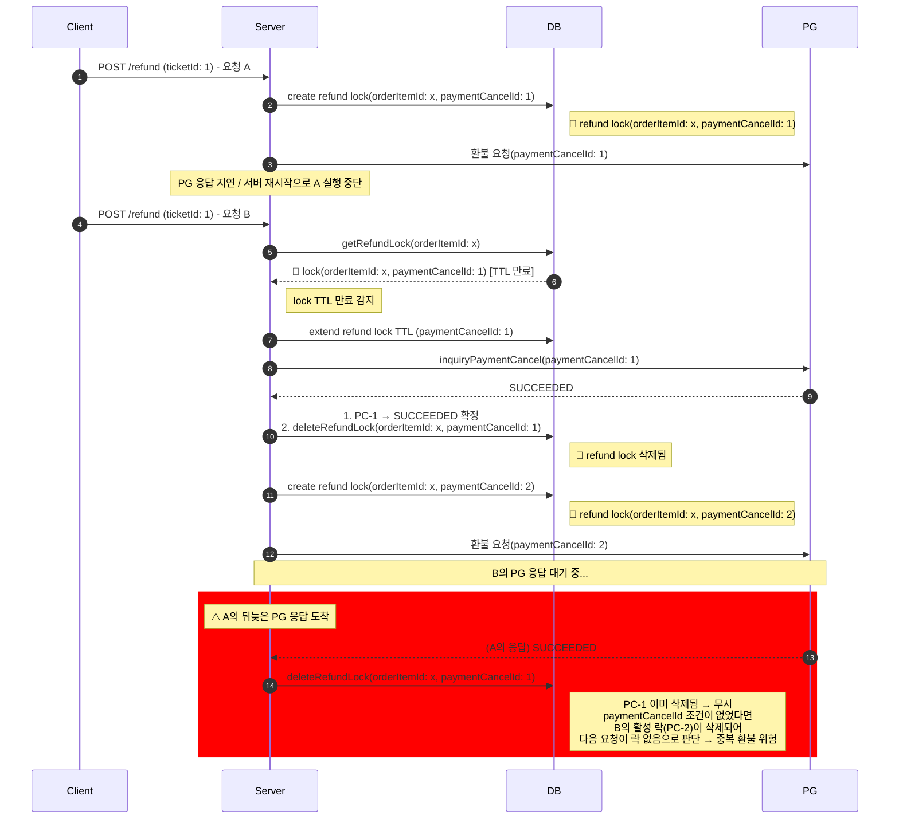
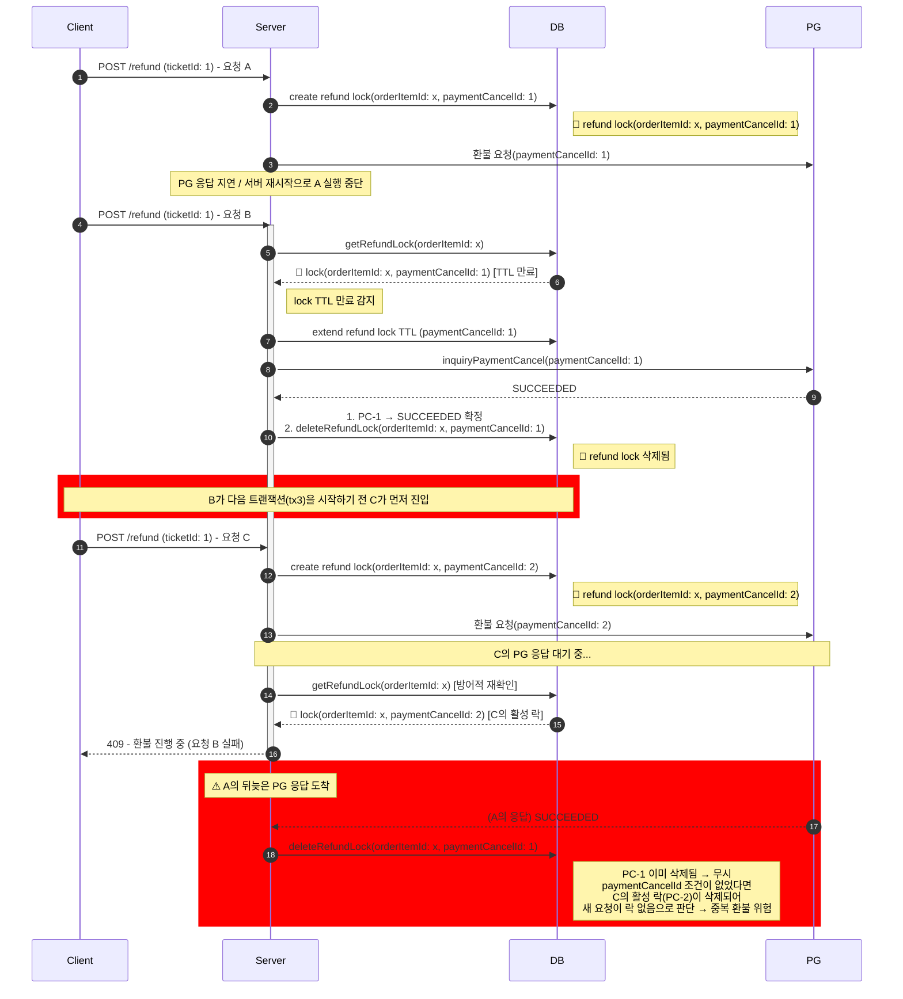

> **과거 설계 이력 — v0.3의 구현 기준은 별도 문서입니다.**
>
> 2026-10-26부터 환불 확정 시 이용 종료·좌석 해제를 먼저 처리하고 지급을 분리합니다. PG 실패로 이용권을 복구하지 않습니다. 이 문서의 승인 대기·PG 성공 시 소멸·RefundLock 신규 사용 설명은 당시 설계 기록입니다. 현재 기준은 [002 기능 명세](../../specs/002-refund-completion/spec.md)와 [데이터 모델](../../specs/002-refund-completion/data-model.md)입니다. 소스가 새 설계대로 구현됐다는 뜻은 아닙니다.

# 환불 락 소유권 토큰 — `paymentCancelId`가 `RefundLock`에 있는 이유

`RefundLock`에는 PK인 `orderItemId` 외에 `paymentCancelId`가 함께 있다.
이 문서는 그 이유를 구체적인 시나리오와 비유로 설명한다.

관련 문서:
- [환불 동시 진행 방지 프로세스](./환불_동시_진행_방지_프로세스.md)
- [환불 스키마 설계 근거 모음](./환불_스키마_설계_근거_모음.md)

---

## 스키마

```prisma
model RefundLock {
  orderItemId     String   @id @map("order_item_id")
  paymentCancelId String   @map("payment_cancel_id")
  expiresAt       DateTime @map("expires_at")
  ...
}
```

---

## `orderItemId`만으로 부족한 이유

**`orderItemId`는 "무엇이 잠겼는가"를 답하고, `paymentCancelId`는 "누가
잠갔는가"를 답한다.** 두 필드의 목적이 다르다.

- `orderItemId`(PK): 같은 상품에 대해 미해결 락이 두 개 이상 존재할 수
  없다는 유니크 제약. "지금 이 상품, 처리 중인가?"라는 질문에는 이것만으로 충분하다.
- `paymentCancelId`: 락을 **해제**할 때 "내가 획득한 바로 그 락인지"
  확인하는 소유권 토큰. "지금 걸려 있는 이 락이 내 것이 맞는가?"라는
  질문에는 `orderItemId`만으로 답할 수 없다.

> **☝️ Note**
> paymentCancelId가 반드시 필요한 경우는 오직 **"내 락이 이미 다른 요청의 락으로 교체된 상태에서 뒤늦게 삭제를 시도할 때"** 뿐이다.
---

## 구체적 시나리오

> **구현 참고**: 만료된 락은 곧바로 삭제되고 새 락이 생성되는 게 아니라,
> PG에 진짜 상태를 물어보는 동안 **같은 락(`paymentCancelId`)을
> 연장(extend)해서 선점**한다. PG 응답을 받아 확정 처리를 마친 뒤에야
> 그 락을 삭제한다(`RefundService.acquireStaleLock` / `clearStaleLock` 참고).

### 다이어그램 (B가 PC-2 보유 중 A 응답 도착)



1. **요청 A**가 `orderItemId = X`에 대해 락 획득(`paymentCancelId = PC-1`, TTL 1분). PG 호출 → 응답 지연 또는 서버 재시작으로 실행 흐름 중단.
2. TTL 만료. **요청 B**가 X를 신청 → `acquireStaleLock`이 만료 락(PC-1)을 감지하고 선점(연장) → PG에 PC-1 상태 조회 → SUCCEEDED 확정 → PC-1 락 삭제. B는 이어서 자신의 환불을 위해 새 락(PC-2)을 생성하고 PG 응답을 대기 중.
3. 이때 **A의 뒤늦은 PG 응답**이 도착해 PC-1 확정 처리를 재개한다. 확정 자체는 재검증 단계에서 걸러지지만, 이후 락 삭제 시 `paymentCancelId` 조건이 없으면 `orderItemId = X` 만으로 삭제가 실행되어 **B의 활성 락(PC-2)이 제거된다 → 새 요청이 진입 가능해져 중복 환불 위험**. `paymentCancelId = PC-1` 조건이 있으면 이미 삭제된 PC-1을 찾지 못해 조용히 무시되고 B의 락은 보호된다.

### 다이어그램 (B·C 경합 포함)



1. **요청 A**가 `orderItemId = X`에 대해 락 획득(`paymentCancelId = PC-1`, TTL 1분). PG 호출 → 응답 지연 또는 서버 재시작으로 실행 흐름 중단.
2. TTL 만료. **요청 B**가 X를 신청 → `acquireStaleLock`이 만료 락(PC-1)을 감지하고 선점(연장) → PG에 PC-1 상태 조회 → SUCCEEDED 확정 → PC-1 락 삭제. 이어서 **B 자신의 환불을 위해 새 락(PC-2) 생성 시도**.
3. 그 사이 **요청 C**가 X를 신청해 PC-2 락을 먼저 선점 → B는 409로 실패. C는 PG 호출 후 응답 대기 중(PC-2 락 활성 상태).
4. 이때 **A의 뒤늦은 PG 응답**이 도착해 PC-1 확정 처리를 재개한다. 확정 자체는 재검증 단계에서 걸러지지만, 이후 락 삭제 시 `paymentCancelId` 조건이 없으면 `orderItemId = X` 만으로 삭제가 실행되어 **C의 활성 락(PC-2)이 제거된다 → 새 요청이 진입 가능해져 중복 환불 위험**. `paymentCancelId = PC-1` 조건이 있으면 이미 삭제된 PC-1을 찾지 못해 조용히 무시되고 C의 락은 보호된다.

`paymentCancelId`를 조건에 포함하면(`WHERE orderItemId = X AND paymentCancelId = 'PC-1'`),
A의 삭제 시도는 현재 X에 걸린 락이 `PC-2`이므로 조건에 맞는 행이 없어
**아무 일도 하지 않는다**(0 rows affected). C의 락은 안전하게 보호된다.

이는 분산 락 패턴에서 "락을 걸 때 발급한 토큰과 해제할 때 제시하는 토큰이
같은지 검증"하는 것(예: Redis 분산 락의 `SETNX` + unique value 검증)과 동일한 이유다.

---

## 비유: 사물함 열쇠

X번 사물함(`orderItemId`)을 여러 사람이 시간차를 두고 쓴다고 하자.

1. **A**가 X번 사물함을 쓰려고 열쇠를 받음(열쇠 번호 `PC-1`).
2. A가 너무 오래 걸려서 관리자가 확인하러 온다. **이때 열쇠를 곧바로
   회수하지 않고, "지금 이 열쇠가 실제로 쓰이고 있는지" 먼저 확인**한다
   (TTL 만료 = 확인이 필요하다는 신호일 뿐, 즉시 회수가 아니다). 확인
   결과(A가 이미 다 쓴 것으로 확인됨) 열쇠 `PC-1`을 그제서야 회수하고
   사물함을 비운다.
3. **C**가 X번 사물함에 새 열쇠(`PC-2`)를 받아 지금 쓰는 중.
4. 이때 **A가 뒤늦게 나타나** "나 다 썼어, 사물함 반납할게"라고 한다.

A가 들고 있는 건 `PC-1` 열쇠지만, 지금 X번 사물함에 꽂혀 있는 건
`PC-2`(C의 것)이다. 시스템이 "X번 반납 요청이니 X번 비워"라고만
처리하면 C가 아직 쓰고 있는데 사물함이 강제로 비워진다. 하지만 "네가
들고 있는 열쇠 번호(`PC-1`)가 지금 X번에 꽂힌 열쇠 번호(`PC-2`)와
같아?"를 먼저 확인하면, 다르므로 A의 반납 요청은 무시된다.
`paymentCancelId`가 바로 이 "내가 받았던 그 열쇠 번호"에 해당한다.

---

## `pgTransactionId`로 대체할 수 없는 이유

`PaymentCancel.pgTransactionId`는 PG 응답이 왔을 때 "어느 `PaymentCancel`인지"
찾는 매칭 키이지, 락의 소유권 토큰이 아니다. 두 가지 이유로 대체 불가하다.

1. **시점이 다르다.** 락은 PG를 호출하기 **이전**(`PaymentCancel` 생성
   직후)에 건다. `pgTransactionId`는 PG 응답이 돌아온 후에 채워지므로
   락을 거는 시점에는 아직 `null`이다.
   (`pgTransactionId String? @unique`로 nullable인 것이 그 근거.)
2. **역할이 다르다.** `pgTransactionId`는 PG(외부 시스템) 관점의 거래
   식별자이고, `paymentCancelId`는 우리 시스템 내부 PK다. 외부 식별자를
   소유권 토큰으로 쓰면 PG 연동 방식이 바뀔 때 락 테이블 스키마까지
   영향을 받는 불필요한 결합이 생긴다.

