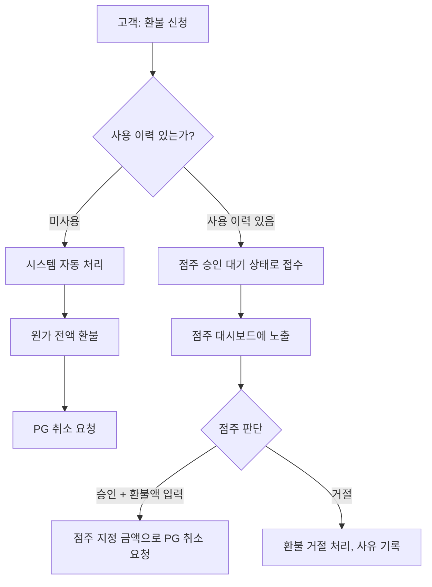
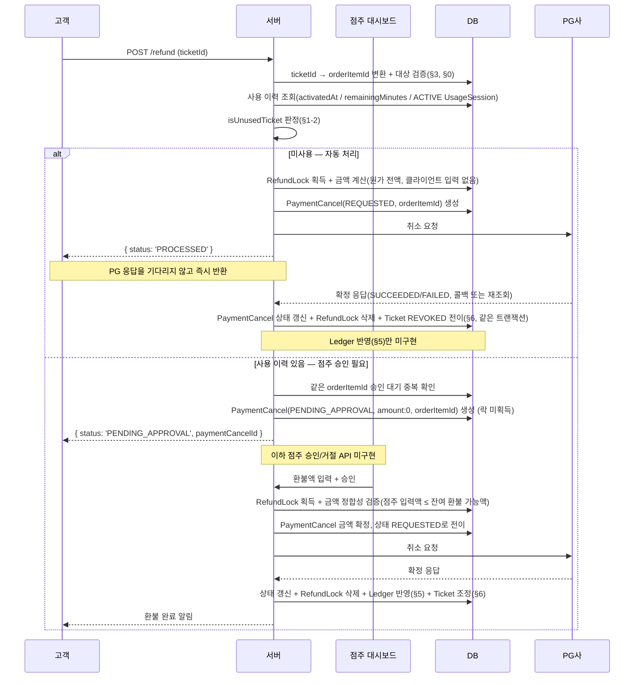

> **과거 설계 이력 — v0.3의 구현 기준은 별도 문서입니다.**
>
> 2026-10-26부터 환불 확정 시 이용 종료·좌석 해제를 먼저 처리하고 지급을 분리합니다. PG 실패로 이용권을 복구하지 않습니다. 이 문서의 승인 대기·PG 성공 시 소멸·RefundLock 신규 사용 설명은 당시 설계 기록입니다. 현재 기준은 [002 기능 명세](../../specs/002-refund-completion/spec.md)와 [데이터 모델](../../specs/002-refund-completion/data-model.md)입니다. 소스가 새 설계대로 구현됐다는 뜻은 아닙니다.

# 환불 정책 문서

## 한눈에 보는 정책 요약

> 각 정책을 한 줄로 압축한 색인이다 — 근거와 예외, 미결 사항은 § 링크를 눌러 본문을 참고한다.

### 1. 환불 신청·승인

| 정책 | 한 줄 요약 | 상태 | 참고 |
|---|---|---|---|
| 환불 신청 단위 | 고객은 `ticketId` 하나로 환불을 신청하며, 서버는 이를 `orderItemId`로 변환해 처리한다 | 구현됨 | [§0](#0-환불의-시작점--order-orderitem-ticket) |
| 환불 처리 모델 | 미사용 티켓은 자동 환불, 사용 이력이 있는 티켓은 점주 승인 후 환불하는 하이브리드 방식 | 구현됨 | [§1-1](#1-1-왜-자동수동-하이브리드인가) |
| 미사용 판정 — 정기권 | `activatedAt IS NULL`이면 미사용으로 판단한다 | 구현됨 | [§1-2](#1-2-분기-기준) |
| 미사용 판정 — 시간권 | `remainingMinutes = purchasedMinutes`이면 미사용으로 판단한다 | 구현됨 | [§1-2](#1-2-분기-기준) |
| 이용 중인 티켓 | `UsageSession`이 `ACTIVE`이면 다른 조건과 무관하게 사용 이력이 있는 것으로 판단한다 | 구현됨 | [§1-2](#1-2-분기-기준) |
| 환불 금액 결정 권한 | 고객은 환불액을 지정할 수 없다 — 미사용 건은 원가 전액 자동, 사용 이력 건은 점주가 결정한다 | 구현됨(자동) / 미구현(승인) | [§1-3](#1-3-신청승인-주체와-채널) |
| 점주 입력 환불액 상한 | 점주 입력 금액은 `OrderItem` 원가를 초과할 수 없다(초과 시 400 거부) | 정책 확정, 구현 대기 | [§1-3](#1-3-신청승인-주체와-채널) |
| 점주 입력 환불액 하한 | 하한은 두지 않는다(0원 승인도 허용) | 정책 확정, 구현 대기 | [§1-3](#1-3-신청승인-주체와-채널) |
| 승인 대기 중 티켓 이용 | `PaymentCancelStatus.PENDING_APPROVAL` 상태에서도 고객은 티켓을 계속 사용할 수 있고, 점주는 승인 시점의 최신 상태로 판단한다 | 정책 확정, 구현 대기 | [§1-3](#1-3-신청승인-주체와-채널) |
| 승인 대기 중 티켓 소진 | 완전히 소진(만료/잔여 0분)돼도 자동 거절하지 않고 점주 판단에 맡긴다 | 정책 확정, 구현 대기 | [§1-3](#1-3-신청승인-주체와-채널) |
| 승인 대기 중복 신청 | 같은 `orderItemId`로 `PaymentCancelStatus.PENDING_APPROVAL` 건이 이미 있으면 새 신청을 409로 거부한다 | 구현됨 | [§1-3](#1-3-신청승인-주체와-채널) |
| 이용 중 환불 신청 | `ACTIVE` 세션이 있어도 신청 자체는 허용하고, 점주 승인 대상으로 분류한다 | 구현됨 | [§3](#3-환불-대상-검증) |

### 2. 환불 금액·대상 검증

| 정책 | 한 줄 요약 | 상태 | 참고 |
|---|---|---|---|
| 미사용 환불 금액 | 사용하지 않은 티켓은 일할 계산 없이 원가 전액을 환불한다 | 구현됨 | [§2](#2-환불-금액-산정-미사용-건-자동-계산) |
| 사용 이력 건 환불 금액 | 시스템이 자동 산정하지 않고, 점주가 매장 운영 정책에 따라 결정한다 | 미구현(승인) | [§2](#2-환불-금액-산정-미사용-건-자동-계산) |
| 환불액 참고 제안 | 점주 승인 화면에 일할 계산 기반 참고 금액을 보여줄지는 미결정 | 미결 | [§2](#2-환불-금액-산정-미사용-건-자동-계산) |
| 티켓 소유권 검증 | 요청한 `ticketId`가 고객 본인 소유인지 확인하고, 아니면 거부한다 | 구현됨 | [§3](#3-환불-대상-검증) |
| 결제 상태 검증 | 연결된 `Payment`가 `SUCCESS` 상태인 경우에만 환불 대상으로 인정한다 | 구현됨 | [§3](#3-환불-대상-검증) |
| 이미 환불된 티켓 | 이미 `REVOKED`인 티켓은 락 획득 전에 즉시 거부하고, `already_refunded` 확인으로 이중 방어한다 | 구현됨(자동) | [§3](#3-환불-대상-검증), [§6](#6-티켓-상태-반영) |
| 환불 단위 | 하나의 `OrderItem`에 대한 환불은 원칙적으로 1회만 허용 — 부분 환불 후 계속 보유하는 모델은 쓰지 않는다 | 구현됨(자동) | [§6](#6-티켓-상태-반영) |

### 3. 동시성 제어·PG 취소

| 정책 | 한 줄 요약 | 상태 | 참고 |
|---|---|---|---|
| 자동 환불 락 | 미사용 환불은 `RefundLock` 획득 → 금액 검증 → `PaymentCancel` 생성 → PG 취소 요청 순으로 진행한다 | 구현됨 | [§4](#4-동시성-제어) |
| 점주 승인 대기 중 락 | 승인 대기 단계에서는 락을 걸지 않고, 점주가 승인해 PG 취소를 실행하는 시점에 획득한다 | 미구현(승인) | [§4](#4-동시성-제어) |
| PG 취소 확정 | 성공 확정 시 `PaymentCancel` 상태 갱신 + 락 해제를 같은 트랜잭션으로 묶고, 미사용 경로는 티켓도 함께 무효화한다 | 구현됨(자동) | [§5](#5-정산ledger-연동) |
| PG 응답 대기 | 환불 신청 API는 PG 응답을 기다리지 않고 먼저 응답하며, 이후 콜백 또는 재조회로 결과를 확정한다 | 구현됨 | [환불_처리_시퀀스.md](./환불_처리_시퀀스.md) |
| PG 재시도 및 락 복구 | PG 재시도와 만료된 락의 TTL 기반 복구는 별도 동시성 설계 문서의 절차를 따른다 | 구현됨 | [환불_동시_진행_방지_프로세스.md](./환불_동시_진행_방지_프로세스.md) |

### 4. 티켓 상태 변경

| 정책 | 한 줄 요약 | 상태 | 참고 |
|---|---|---|---|
| 미사용 환불 성공 | PG 취소 성공이 확정되는 시점에 `Ticket.status`를 `REVOKED`로 전이한다 | 구현됨 | [§6](#6-티켓-상태-반영) |
| 점주 승인 대기 | `PaymentCancelStatus.PENDING_APPROVAL` 상태에서는 티켓 상태를 바꾸지 않고 기존 `ACTIVE`/`UNUSED`를 유지한다 | 정책 확정, 구현 대기 | [§6](#6-티켓-상태-반영) |
| 점주 승인 환불 성공 | 점주 승인 경로도 PG 취소 성공이 확정되는 시점에만 `REVOKED`로 전이한다 | 정책 확정, 구현 대기 | [§6](#6-티켓-상태-반영) |
| 점주 승인 거절 | 상태를 바꾼 적이 없으므로 거절 시 원복이나 `TicketPause` 유효기간 보정이 불필요하다 | 정책 확정 | [§6](#6-티켓-상태-반영) |

### 5. 정산(Ledger) 연동

| 정책 | 한 줄 요약 | 상태 | 참고 |
|---|---|---|---|
| 환불의 정산 반영 시점 | `PaymentCancel.status`가 `SUCCEEDED`로 확정된 시점에만 Ledger에 음수 레코드를 추가한다 | 미구현 | [§5](#5-정산ledger-연동) |
| 중복 반영 방지 | 같은 `paymentCancelId`로 이미 레코드가 있으면 추가하지 않는다(`@unique` FK로 DB가 보장) | **구현 완료**(스키마) | [§5](#5-정산ledger-연동) |

> 정산(Ledger) 시스템 자체의 설계(append-only 원장, 배치/조회 분리,
> `SettlementBatch`, `CLAWBACK_PENDING` 제거 등)는
> [정산_정책.md](./정산_정책.md)로 분리됐다(2026-10-09) — 거기서
> 더 상세한 정책 요약을 확인할 수 있다.

> **구현 우선순위 관점**: 미사용 자동 환불과 그 동시성 제어는 상당 부분
> 구현돼 있지만, 점주 승인/거절 API와 Ledger 연동은 아직 없다. 승인
> API를 만들 때 점주 입력 금액 상한 검증, 승인 시점 락 획득, 승인
> 성공 시 티켓 `REVOKED` 전이를 함께 반영해야 한다([TODO.md](../TODO.md) #1 참고).

---

이 문서는 환불 요청부터 정산 반영까지 전체 흐름을 다룬다. 스키마 수준의
세부 설계는 아래 두 문서에 이미 정리되어 있으므로, 이 문서는 그 위에서
**정책(무엇을, 언제, 누가 결정하는가)**과 **end-to-end 흐름**을 다룬다.

핵심 스키마의 역할을 먼저 짚으면: **`PaymentCancel`은 "PG에 취소를
요청했다"는 실행 기록 1건**(PG 취소 API 호출 1회에 대응)이며,
`orderItemId` FK로 대상 상품(`OrderItem`)을 직접 참조한다. 한 번의
환불 신청은 항상 상품 1건을 대상으로 하므로([§0](#0-환불의-시작점--order-orderitem-ticket) 참고),
`PaymentCancel`과 `OrderItem`은 N:1 관계다(하나의 상품에 대해 취소
시도가 여러 번 있을 수 있으나, 하나의 취소는 항상 상품 1건만
대상으로 한다).

- [환불을 상품 단위로 추적하는 구조](./환불_상품단위_추적_구조.md) — `PaymentCancel`의 `orderItemId` 직접 참조 구조
- [환불 동시 진행 방지 프로세스](./환불_동시_진행_방지_프로세스.md) — `RefundLock`, 락 획득/해제, PG 재시도
- [정산_정책.md](./정산_정책.md) — 정산(Ledger) 시스템 자체의 설계(이 문서 §5에서 분리됨)

> **구현 상태 (2026-10-09 기준)**:
> - **구현 완료**: §0(ticketId 단건 신청), §1(자동/수동 분기 로직 — `isUnusedTicket`),
>   §3(소유자/결제 상태 검증, 이용 중 신청 허용), §4(동시성 제어, 미사용
>   경로 한정), §6(미사용 경로의 `REVOKED` 전이)
> - **정책 확정, 구현 대기**: §1-3(승인 대기 중 이용 허용, 환불액 상한
>   검증), §6(승인 경로는 `Ticket` 상태를 건드리지 않음) — 점주 승인
>   API(`docs/TODO.md` #1) 구현 시 함께 반영
> - **부분 구현**: §2(미사용 건 원가 전액 계산은 구현됨, 점주 승인 UI의 참고
>   환불액 제안은 미결 — §8 #1)
> - **미구현**: 점주 승인/거절 API 자체(§1-3, `PaymentCancel.status = PENDING_APPROVAL`
>   레코드만 생성하고 멈춤), §5(환불 확정 시 Ledger 레코드 삽입 — 정산
>   시스템 자체의 구현 상태는 [정산_정책.md](./정산_정책.md) 참고)
> - 관련 코드: `src/refund/refund.service.ts`, `refund.repository.ts`,
>   `refund.types.ts`, `dto/refund.dto.ts`

---

## 0. 환불의 시작점 — Order? OrderItem? Ticket?

환불을 어느 단위로 다루는지가 세 계층(`Order`, `OrderItem`, `Ticket`)에
걸쳐 있어 혼동하기 쉽다. 각 계층의 역할이 다르다.

| 계층 | 역할 | 이 문서에서의 위치 |
|---|---|---|
| `Order` | 결제 단위(한 번의 주문에 여러 상품이 담길 수 있음) | 환불 단위 아님 — [환불_상품단위_추적_구조.md](./환불_상품단위_추적_구조.md#왜-paymentcancel과-별개-모델로-나눴는가)가 이미 "환불은 상품 단위로 결정되지만 실행은 결제 단위"라고 정리함 |
| `OrderItem` | `PaymentCancel`/`RefundLock`의 물리적 키. 원가(`price`) 스냅샷을 들고 있어 **금액 정합성 검증의 기준 단위** | 서버 내부 처리 단위(§4의 락, 누적 금액 검증) |
| `Ticket` | 사용 이력 판정에 필요한 상태(`activatedAt`, `remainingMinutes`)를 들고 있고, `Ticket.orderItemId`가 unique라 `OrderItem`과 1:1. 고객이 화면에서 실제로 보고 고르는 대상("내 티켓 목록") | **환불 신청 API의 입력 단위** |

**신청 시 받는 식별자는 `ticketId`다.** 고객은 상품이 아니라 "내가 산
이용권"을 보고 환불을 요청하므로, API 표면은 `ticketId`를 받는 것이
자연스럽다. 서버는 요청을 받는 즉시 `Ticket.orderItemId`(unique)로 대상
`OrderItem`을 확정하고, 이후 §3~§7의 모든 처리(락 획득, 금액 검증,
`PaymentCancel` 생성)는 그 `orderItemId`를 기준으로 진행한다. 즉
`ticketId → orderItemId` 변환은 API 진입 시점에 한 번만 일어나는 얇은
계층이고, 그 아래 스키마·동시성 설계는 기존 두 문서가 정한
`OrderItem` 기준을 그대로 따른다.

**한 번의 신청은 티켓 1개만 대상으로 한다.** 한 주문에 정기권+시간권처럼
서로 다른 상품이 섞여 있으면, 상품마다 승인 분기(§1)와 사용 이력
판정 기준이 다를 수 있다. 여러 티켓을 한 요청에 묶으면 "일부는 자동
승인, 일부는 점주 승인 대기"처럼 응답이 갈리는 케이스를 API 레벨에서
따로 설계해야 한다. 여러 상품을 동시에 환불하고 싶으면 클라이언트가
`ticketId`별로 여러 번 요청한다 — 서버 내부적으로는 각 요청이 독립된
트랜잭션이므로 문제없이 병렬 처리된다. (기존 문서의 "다건 전체 취소"
시나리오는 이 방식이 여러 번 반복된 결과로 자연스럽게 커버된다. PG
취소 자체를 한 번의 API 호출로 묶어 여러 상품을 동시에 취소하는
케이스는 이 프로젝트에서 다루지 않는다.)

---

## 1. 환불 신청·승인 모델

### 1-1. 왜 자동/수동 하이브리드인가

환불 승인 모델은 크게 세 갈래로 나뉜다.

| 모델 | 특징 | 이 프로젝트 채택 여부 |   
|---|---|---|
| 완전 자동(고객 요청 즉시 처리) | 빠르지만 오남용·과다 환불 위험 관리가 어려움 | 미사용 건에 한해 채택 |
| 완전 수동(모든 건 점주 승인) | 안전하지만 미사용 단순 취소까지 점주를 기다리게 해 UX 저하 | 미채택 |
| 하이브리드(조건부 자동 + 조건부 수동) | 판단이 기계적인 건은 자동, 재량이 필요한 건만 사람에게 | **채택** |

이 프로젝트는 PC방/스터디카페 좌석 예약 서비스로, 정기권/시간권을
**전혀 쓰지 않은 상태의 취소**는 환불액 산정에 재량이 개입할 여지가 없다
(원가 그대로 돌려주면 된다). 반면 **일부라도 사용한 뒤의 취소**는 원가
산정에 PG/가맹점 수수료, 사용 기간 산정 방식 등 매장 운영 정책이 개입할
여지가 있다. 이 둘을 같은 절차로 묶으면 단순 건까지 점주 대기가
필요해지거나, 반대로 재량이 필요한 건까지 기계적으로 처리하는 문제가
생긴다. 그래서 **판단 기준을 "사용 이력 유무"로 나눠 분기**한다.

### 1-2. 분기 기준

| 상품 | 미사용 판정 기준 |
|---|---|
| 정기권(`PERIOD`) | `Ticket.activatedAt IS NULL` (아직 활성화 전) |
| 시간권(`TIME`) | `Ticket.remainingMinutes = Ticket.purchasedMinutes` (한 번도 소진 안 됨) |
| 공통(우선 검사) | 진행 중인 `UsageSession`(status = `ACTIVE`)이 있으면 위 조건과 무관하게 무조건 사용 이력 있음으로 판정 |

> **구현 세부사항**: `Ticket.remainingMinutes`는 `UsageSession`이 **종료**되는
> 시점에만 차감되는 사후 정산 방식이라(`usage-session.repository.ts`의
> `endUsageSession()`), 지금 이용 중인 세션이 있어도 `remainingMinutes`가
> 아직 구매 시점 값 그대로일 수 있다. 이 상태를 `remainingMinutes` 비교만으로
> "미사용"으로 잘못 판정하는 걸 막기 위해, ACTIVE 세션 존재 여부를 최우선으로
> 검사한다(`RefundService.isUnusedTicket()`, `RefundRepository.getTicketById()`가
> `usageSessions`를 `status: ACTIVE`로 필터링해 함께 조회).

### 1-3. 신청/승인 주체와 채널

- **고객**: 환불 신청 API(`POST /refund`)로 직접 신청한다. 요청 본문은
  `ticketId` 하나뿐이다([§0](#0-환불의-시작점--order-orderitem-ticket) 참고,
  `RefundDto`에 `refundAmount` 필드 없음 — 고객은 금액을 지정할 권한이 없다).
  서버가 이를 `orderItemId`로 변환해 이후 처리를 진행한다.
- **미사용 건**: 신청과 동시에 시스템이 [§2](#2-환불-금액-산정)의 규칙대로
  전액 환불을 자동 확정하고, 곧바로 [§4](#4-동시성-제어)의 락 획득 →
  PG 취소 흐름으로 들어간다. 점주 개입 없음. (`RefundService.refund()`가
  `{ status: 'PROCESSED' }`를 반환)
- **사용 이력 있는 건**: 신청 시점에는 금액을 확정하지 않고
  `PaymentCancel`(status: `PaymentCancelStatus.PENDING_APPROVAL`, `amount: 0`, `orderItemId` 연결)만 생성하고 멈춘다
  (`{ status: 'PENDING_APPROVAL', paymentCancelId }` 반환). **점주 승인/거절
  API 자체는 아직 구현되지 않았다** — 이 상태에서 더 진행되는 로직이 없다.
  구현되면 점주가 대시보드에서 건을 확인하고 **환불액을 직접 입력해 승인**하거나
  거절하는 흐름이 될 것이다. 이 금액은 시스템이 자동 계산하지 않는다 — 사용
  기간에 따른 원가 산정(PG 수수료, 가맹점 수수료 등)은 매장 운영 정책의
  재량 영역으로 남겨둔다.
- **승인 대기 중 중복 신청 방지**: 같은 `orderItemId`로 이미 `PaymentCancelStatus.PENDING_APPROVAL`
  상태의 `PaymentCancel`이 있으면 새 신청을 `DomainConflictError`(409)로
  거부한다(`RefundRepository.createPendingApprovalPaymentCancel` 내부에서
  같은 트랜잭션으로 확인+생성). §4에서 "확인 필요"로 남겼던 지점이 이 방식으로
  해결됨.

> **왜 사용 이력 건의 환불액을 시스템이 계산하지 않는가**: 계속적 용역
> 계약의 중도 해지 시 "미사용분을 사용 기간에 비례해 환불"하는 것이
> 국내 소비자 보호 관행상 일반적인 원칙이지만, 정확한 공제 항목(PG
> 수수료, 위약금 비율 등)은 매장·업종마다 다르고 법적으로 세밀한 검토가
> 필요한 영역이다. 시스템이 임의로 계산식을 강제하면 오히려 매장별
> 정책 차이를 반영하지 못하거나 법적 리스크를 시스템이 떠안게 된다.
> 그래서 "미사용 → 원가 그대로"라는 다툼의 여지가 없는 케이스만
> 자동화하고, 나머지는 점주 재량 + 기록(감사 추적)으로 처리한다.

**[결정, 2026-10-09] 점주 입력 환불액의 상한/하한**: 점주가 입력하는
금액은 **`OrderItem` 원가를 상한으로 시스템이 강제**한다 — 원가를
초과하는 입력은 400으로 거부한다(과다 환불 방지를 위한 최소한의
안전장치). 하한은 두지 않는다 — 0원 승인(= 사실상 거절에 가까운
처리)도 점주 재량으로 허용한다. 미구현: 승인 API 자체가 없어 이
검증 로직도 아직 없다.

**[결정, 2026-10-09] 승인 대기(`PaymentCancelStatus.PENDING_APPROVAL`) 중 티켓 이용**:
신청과 동시에 이용을 막지 않는다 — 고객은 점주 승인을 기다리는
동안에도 해당 티켓을 계속 사용할 수 있다. 점주가 언제 승인할지
알 수 없는 상태에서 미리 이용을 막으면 UX가 나빠지기 때문이다.
대신 점주는 **승인 시점의 최신 상태(그 사이 더 소진됐을 수 있는
`remainingMinutes`/`activatedAt` 등)를 보고 환불액을 판단**한다 —
신청 시점 값을 스냅샷해 둘 필요가 없다. 승인 대기 중 티켓이 완전히
소진(시간권 잔여 0분 도달, 정기권 만료)되더라도 시스템이 자동으로
개입하지 않고 **그대로 점주 판단에 맡긴다**(자동 거절/자동 실패
처리 없음). 이 결정으로 "심사 중 상태 신설", "거절 시 원복",
"`TicketPause` 유효기간 보정"은 모두 불필요해졌다 — 상태 자체를
바꾸지 않으므로 되돌릴 것도 없다(아래 [§6](#6-티켓-상태-반영) 참고).

---

## 2. 환불 금액 산정 (미사용 건 자동 계산)

미사용 건은 **일할 계산 없이 원가 전액**을 환불한다. 애초에 사용을
시작하지 않았으므로 일할 계산 자체가 적용될 여지가 없다.

> 최초 논의 단계에서는 "일할 계산(사용일수 비례 차감)"을 정기권/시간권
> 공통 원칙으로 검토했으나, 실제로 일할 계산이 필요한 케이스(사용 이력
> 있는 부분 환불)는 [§1](#1-환불-신청승인-모델)의 분기에 따라 점주
> 재량으로 넘어갔다. 따라서 시스템이 자동으로 실행하는 일할 계산 로직은
> 현재 정책상 없다 — 아래는 **향후 점주 승인 UI가 참고 금액(제안값)을
> 보여주고 싶을 때 쓸 수 있는 참고 공식**으로 남겨둔다.

| 상품 | 참고 공식(점주 승인 UI의 제안값 후보) | 기준일 |
|---|---|---|
| 정기권 | `원가 × (1 - 경과일수 / purchasedDurationDays)` | 경과일수 = `환불신청일 - activatedAt` |
| 시간권 | `원가 × (remainingMinutes / purchasedMinutes)` | 신청 시점의 `remainingMinutes` (진행 중인 `UsageSession`이 있으면 먼저 종료 처리 후 확정된 값 사용) |

**확인 필요**: 점주 승인 UI에 이 참고값을 보여줄지, 아니면 완전 백지
입력으로 둘지는 아직 결정되지 않았다. 참고값을 보여주기로 하면
`OrderItem.price`, `Ticket.purchasedDurationDays`/`activatedAt` 또는
`purchasedMinutes`/`remainingMinutes`를 조회하는 별도 쿼리 서비스가
필요하다.

---

## 3. 환불 대상 검증

환불 신청이 들어오면 금액 계산·승인 분기 이전에 아래 조건을 먼저
검증해야 한다 (기존 두 문서에 없는, 신청 접수 단계의 선행 검증).

- `Ticket`이 해당 요청자의 소유인가 (`Ticket.userId` 확인 — `ticketId`를
  받는 시점에 가장 먼저 검증, [§0](#0-환불의-시작점--order-orderitem-ticket) 참고) **[구현됨]**
- 해당 `Payment`가 `SUCCESS` 상태인가 (결제 완료되지 않은 건은 환불 대상이
  아니라 결제 취소/재시도 대상) **[구현됨]**
- 이미 전액 환불된 상품인가 — 미사용 자동 처리 경로에서는 `createRefundWithLock`이
  `calculateRefundableAmount`의 `refund_amount > refundable_amount` 비교로
  차단한다 **[구현됨, 다만 §6과 연결된 구조적 한계 있음 — 아래 §6 참고]**.
  사용 이력 있는 건(점주 승인 경로)에서는 아직 검증 지점 자체가 없음(승인
  API 미구현).
- 진행 중인 `UsageSession`(현재 좌석 이용 중)이 있는가 — **[구현됨, 다만
  "신청 자체를 막는" 방식이 아니라 "자동/수동 분기에 반영하는" 방식으로
  구현됨]**. 애초에 우려했던 "자동 승인 대상에는 사용 이력이 없어야
  하므로 문제되지 않는다"는 전제가 실제로는 성립하지 않는 것으로
  확인되어([§1-2](#1-2-분기-기준) 참고, `remainingMinutes`가 세션 종료 시에만
  차감되는 사후 정산 방식이라 진행 중 세션이 있어도 "미사용"으로 오판될 수
  있었음), ACTIVE 세션이 있으면 `remainingMinutes`/`activatedAt` 값과
  무관하게 무조건 "사용 이력 있음"(점주 승인 대상)으로 분류하도록
  `isUnusedTicket()`에 반영했다.

  **[결정, 2026-10-09] 이용 중 신청 자체는 허용한다(현재 구현 유지)**:
  좌석을 점유한 채로 환불을 신청하는 상황을 막지 않는다. 어차피 승인
  대기 중에도 이용 자체를 막지 않기로 했으므로([§1-3](#1-3-신청승인-주체와-채널)
  참고), 신청 시점에 이용 중인지를 따로 막을 이유가 없다 — "이용 중에
  환불 요청 → 점주가 승인하는 동안 계속 이용"하는 상태는 애매함이 아니라
  의도된 정책이다.

---

## 4. 동시성 제어

락 획득, 금액 정합성 검증, PG 재시도, TTL 자가 치유의 상세 메커니즘은
[환불 동시 진행 방지 프로세스](./환불_동시_진행_방지_프로세스.md)를 그대로
따른다. 이 문서에서 추가되는 것은 **승인 분기가 락 획득 시점에 어떤
영향을 주는가** 뿐이다.

- **미사용 자동 처리 [구현됨]**: 신청 즉시 같은 요청 안에서 락 획득 → 금액 계산
  (원가 전액, 클라이언트 입력 없음) → `PaymentCancel` 생성 →
  PG 호출까지 이어진다. 상세 흐름은 [환불_처리_시퀀스.md](./환불_처리_시퀀스.md) 참고.
- **점주 승인 대상 [부분 구현됨]**: 신청 시점에는 **락을 걸지 않는다.** 승인 대기
  상태는 "아직 실행이 결정되지 않은 요청"이므로, 이 시점에 `RefundLock`을
  잡으면 점주가 승인/거절을 미루는 동안 다른 정당한 환불 시도(예: 같은
  주문의 다른 상품)를 막을 이유가 없다. 락은 **점주가 승인해 실제 PG
  취소를 실행하는 시점**에 획득할 예정이나, 그 승인 API 자체가 아직
  구현되지 않아 이 부분은 미완성이다. 승인 대기 중 같은 `orderItemId`에
  대한 중복 신청 방지는 **구현 완료** — `PaymentCancel`에 별도 제약을
  추가하지 않고, `createPendingApprovalPaymentCancel`이 같은 트랜잭션
  안에서 "이 `orderItemId`로 `PaymentCancelStatus.PENDING_APPROVAL` 상태가 이미 있는가"를
  확인한 뒤 있으면 `DomainConflictError`(409)로 거부하는 애플리케이션
  레벨 검사로 해결했다.

---

## 5. 정산(Ledger) 연동

정산(Ledger) 시스템 자체의 설계 — append-only 원장 모델, 정산
배치와 조회의 분리, `SettlementBatch`를 통한 배치 실행 추적 — 는
[정산_정책.md](./정산_정책.md)로 분리됐다(2026-10-09). 이 문서에
남는 건 "환불이 정산에 어떤 신호를 보내는가"뿐이다.

**환불이 정산에 영향을 주는 시점은 `PaymentCancel.status`가
`SUCCEEDED`로 확정되는 순간(PG가 취소를 확정한 시점) 하나뿐이다.**
`REQUESTED`(PG 응답 대기) 상태에서는 아직 실제로 돈이 나간 게
아니므로 Ledger에 아무것도 반영하지 않는다. 이 시점에 "환불 레코드
하나를 원장에 추가"하는 것으로 끝나며, 그 추가가 정산 예정액
계산·배치 마감에 어떻게 반영되는지는 [정산_정책.md](./정산_정책.md)의
범위다.

이 삽입은 [환불 동시 진행 방지 프로세스 §3](./환불_동시_진행_방지_프로세스.md#3-확정-처리)의
"확정 처리" 트랜잭션에 자연스럽게 추가된다 — `PaymentCancel` 상태
갱신, `RefundLock` 삭제, 신규 `Ledger` 레코드 삽입을 **같은
트랜잭션**으로 묶어야 세 상태가 서로 어긋나지 않는다.

**[구현 완료, 2026-10-09]** `Ledger.paymentCancelId`(nullable,
`@unique` FK → `PaymentCancel`)를 추가해 "같은 환불에 대해 레코드를
두 번 추가하지 않는다"는 멱등성을 DB 레벨에서 보장한다 — 환불
레코드는 이 필드로 자신을 만든 `PaymentCancel`을 가리키고, 매출
레코드는 `null`이다. 그 외 스키마 변경(`orderId` 전환,
`SettlementBatch` 신설, `CLAWBACK_PENDING` 제거)과 남은 미결
사항(회수 미달 처리 방식)은 정산 시스템 자체의 설계이므로
[정산_정책.md §5](./정산_정책.md#5-스키마-변경완료-및-남은-미결-사항)
참고.

---

## 6. 티켓 상태 반영

> **✅ 미사용 자동 처리 경로 해결됨(2026-09-06)**: 
> 환불 1회 원칙에 따라 PG 확정 시 revokeTicket()으로 Ticket.status를 REVOKED로 전이시키고, already_refunded 검증으로 재환불을 이중 방어한다.

> **[결정, 2026-10-09] 점주 승인 경로의 `Ticket` 상태 처리 — 확정됨**:
> 승인 대기 중에는 Ticket 상태를 건드리지 않고, PG 취소가 SUCCEEDED로 확정되는 순간에만 REVOKED로 전이한다.

> **부분 환불 모델 재정의(2026-09-06, 2026-10-09 정정)**: 환불은
> 상품당 1회만 허용한다(일부만 환불받고 나머지는 계속 보유하는 중간
> 단계는 없음). 다만 점주 승인 대기 중에는 티켓 사용 상태를 그대로
> 유지한다 — "환불 신청 즉시 이용권이 종료된다"는 당시 원문 서술은
> 틀렸으며, 바로 위 "점주 승인 경로의 `Ticket` 상태 처리" 결정으로
> 정정됐다. [환불_상품단위_추적_구조.md](./환불_상품단위_추적_구조.md)와
> [환불_처리_시퀀스.md](./환불_처리_시퀀스.md)도 함께 갱신됨.

---

## 7. 전체 흐름 요약

> 아래는 실제 구현 순서를 반영한다(사용 이력 분기가 락 관련 로직보다 먼저
> 일어남 — [§4](#4-동시성-제어) 참고). Ledger 반영은 여전히 미구현이다.
> Ticket 무효화는 미사용 자동 처리 경로에서 해결됐다(§6 참고). 상세 시퀀스는
> [환불_처리_시퀀스.md](./환불_처리_시퀀스.md) 참고.

---

## 8. 미결 정책 정리

이 문서를 작성하며 확인이 필요하다고 표시한 항목을 한 곳에 모은다.
결정되는 대로 각 섹션과 [TODO.md](../TODO.md)에 반영한다.

1. 점주 승인 UI에서 참고 환불액(일할 계산값)을 제안할지 여부 ([§2](#2-환불-금액-산정)) — 미결
2. ~~점주 입력 환불액의 상한/하한 검증 규칙~~ — **해결됨(2026-10-09)**:
   원가를 상한으로 강제, 하한 없음(0원 승인 허용)([§1-3](#1-3-신청승인-주체와-채널))
3. ~~이용 중(`UsageSession` ACTIVE)인 티켓의 환불 신청을 아예 막을지
   여부~~ — **해결됨(2026-10-09)**: 신청 자체를 허용한다(현재 구현
   유지)([§3](#3-환불-대상-검증))
4. ~~승인 대기 상태에서 같은 상품 중복 신청 방지 방식~~ — **해결됨**:
   애플리케이션 레벨 트랜잭션 검사로 구현 완료([§4](#4-동시성-제어))
5. ~~정산 조정 항목을 `Ledger`에 통합할지 별도 모델로 분리할지~~ —
   **재검토로 해소(2026-10-09)**: append-only 원장 모델 채택으로
   "조정"이라는 별도 개념 자체가 없어졌다 — 환불도 그냥 `Ledger`에
   쌓이는 레코드 1건이므로 별도 모델이 불필요. 상세 설계는
   [정산_정책.md §2](./정산_정책.md#2-설계-환불도-하나의-원장-레코드다)로
   분리됨
6. ~~`CLAWBACK_PENDING`의 종결 상태 및 회수 미달(마이너스 정산) 처리
   방식~~ — **일부 해결(2026-10-09)**: append-only 모델 채택으로
   `CLAWBACK_PENDING` 상태 자체를 `prisma/schema.prisma`에서 제거했다.
   남은 미결인 "회수 미달(음수 정산 예정액) 처리 방식"은
   [정산_정책.md §5](./정산_정책.md#5-스키마-변경완료-및-남은-미결-사항)로
   이관됨
7. ~~환불 확정 시 `Ticket` 상태 전이 규칙~~ — **미사용 자동 처리 경로
   해결됨(2026-09-06)**: `revokeTicket()`으로 `REVOKED` 전이 구현
   완료([§6](#6-티켓-상태-반영))
8. ~~하나의 `OrderItem`에 대해 환불이 여러 번(부분) 발생할 수 있는 현재
   설계를 재설계할지~~ — **미사용 자동 처리 경로 해결됨(2026-09-06)**:
   `calculateRefundableAmount`를 "이미 SUCCEEDED 이력 존재 여부" 확인으로
   단순화([§6](#6-티켓-상태-반영), [환불_상품단위_추적_구조.md](./환불_상품단위_추적_구조.md)와도 연결됨)
9. ~~점주 승인 경로(`PaymentCancelStatus.PENDING_APPROVAL`)의 `Ticket` 상태 처리 및
   `TicketPause` 만료일 보정 로직~~ — **해결됨(2026-10-09)**: 승인
   대기 중 이용을 막지 않기로 결정 → 심사 중 상태 신설/원복/유효기간
   보정 모두 불필요([§1-3](#1-3-신청승인-주체와-채널),
   [§6](#6-티켓-상태-반영))
10. ~~정산 조회 시 환불 이력을 찾는 경로가 없음~~ — **해결됨(2026-10-09)**:
    `Ledger.paymentCancelId` FK를 추가해 환불 레코드가 어느
    `PaymentCancel`에서 왔는지 바로 추적 가능. `Ledger.tradeId`도
    `orderId`(FK → `Order`)로 전환해 참조 무결성을 DB가 보장하도록
    바꿨다. 상세 설계는
    [정산_정책.md §5](./정산_정책.md#5-스키마-변경완료-및-남은-미결-사항)로
    분리됨
11. ~~`Ledger`에 환불 추적용 FK 추가 필요~~ — **해결됨(2026-10-09)**:
    `paymentCancelId`(nullable, `@unique`) 추가로 스키마 반영 완료.
    마이그레이션 생성은 아직
    ([정산_정책.md §5](./정산_정책.md#5-스키마-변경완료-및-남은-미결-사항))

**이 목록에서 남은 미결 항목은 1번뿐이다.** 1번(참고 환불액 제안)은
UX 선택의 문제라 승인 API 구현을 막지 않는다 — 이제 점주 승인 API
자체(`docs/TODO.md` #1)를 구현할 조건이 충족됐다(8/9번이 선행
조건이었음). 정산 시스템 자체의 남은 미결(회수 미달 처리 방식)은
[정산_정책.md](./정산_정책.md)로 이관되어 이 목록 밖에서 관리된다.

## 9. 참고

- 스키마: `prisma/schema.prisma`의 `PaymentCancel`, `RefundLock`,
  `Ticket`
- 관련 설계: [환불_상품단위_추적_구조.md](./환불_상품단위_추적_구조.md),
  [환불_동시_진행_방지_프로세스.md](./환불_동시_진행_방지_프로세스.md),
  [정산_정책.md](./정산_정책.md) — 정산(Ledger) 시스템 자체의 설계
- 미구현 항목 추적: [TODO.md](../TODO.md)
