# 환불 처리 시퀀스

`RefundService.refund()` / `clearStaleLock()` / `callback()` 전체 흐름
(2026-09-06 기준, 사용 이력 기반 자동/수동 분기 + Ticket REVOKED 전이
구현 완료).

[[RefundLock_설계노트]]

> **이전 버전과의 차이**: 클라이언트는 더 이상 `refundAmount`를 보내지 않는다
> (`ticketId`만 전송). 미사용 건은 서버가 원가 전액을 자동 계산하고, 사용
> 이력이 있는 건은 점주 승인 시점에 금액이 정해진다(승인 API는 미구현 —
> [환불_정책.md §1](./환불_정책.md#1-환불-신청승인-모델) 참고).
> `refund()`는 공통 검증 후 `processAutoRefund`(미사용) 또는
> `processPendingApproval`(사용 이력)로 위임하는 구조로 분리됐다. 미사용
> 자동 처리 경로는 PG 확정 시 `Ticket.status`를 `REVOKED`로 전이시키고,
> 하나의 상품은 환불 1회로 종료되도록 재설계됐다(아래 "부분 환불 모델
> 재정의 반영 완료" 참고 — 이전엔 "향후 재검토 필요"였음).

```mermaid
sequenceDiagram
    participant Client
    participant Controller as RefundController
    participant Service as RefundService
    participant Repo as RefundRepository
    participant DB as PostgreSQL
    participant PG as PgService(mock)

    Client->>Controller: POST /refund (ticketId)
    Controller->>Service: refund(userId, ticketId, idempotencyKey?)

    Service->>Repo: getTicketById(ticketId)
    Repo->>DB: SELECT ticket + type/activatedAt/remainingMinutes/purchasedMinutes<br/>+ ACTIVE usageSessions + orderItem + order + payments(SUCCESS)
    DB-->>Repo: ticket
    Repo-->>Service: ticket

    alt 티켓 없음 / 본인 아님 / 주문·결제 정보 없음
        Service-->>Controller: DomainNotFoundError / DomainForbiddenError
        Controller-->>Client: 404 / 403
    end

    Service->>Service: isUnusedTicket(ticket)
    note right of Service: ACTIVE 세션이 있으면 remainingMinutes가<br/>아직 차감 전이라도 무조건 "사용 이력 있음".<br/>정기권: activatedAt === null → 미사용<br/>시간권: remainingMinutes === purchasedMinutes → 미사용

    alt 사용 이력 있음 (isUnusedTicket == false)
        Service->>Repo: createPendingApprovalPaymentCancel(paymentId, orderItemId, now, idempotencyKey)
        Repo->>DB: BEGIN TX
        Repo->>DB: 같은 orderItemId로 PENDING_APPROVAL 있는지 확인
        alt 이미 승인 대기 중
            Repo-->>Service: throw DomainConflictError("이미 승인 대기 중인 환불 요청이 있습니다")
            Service-->>Client: 409
        else 없음
            Repo->>DB: PaymentCancel(amount:0, orderItemId, status:PENDING_APPROVAL) 생성
            Repo->>DB: COMMIT TX
            note right of Repo: RefundLock은 만들지 않는다 - 아직 PG에<br/>아무 요청도 나가지 않아 막을 대상(PG 취소<br/>실행 중복) 자체가 없음
        end
        Service-->>Controller: { status: 'PENDING_APPROVAL', paymentCancelId }
        Controller-->>Client: 200 (승인 대기)
    end

    opt 미사용 (isUnusedTicket == true) - 이하 자동 처리 경로
    rect rgb(39, 39, 83)
    note over Service,DB: 1차 트랜잭션 - 락 확인 + 만료 시 선점(연장)
    Service->>Repo: runInTransaction(tx1)
    Repo->>DB: getRefundLock(orderItemId)
    DB-->>Repo: refundLock | null

    alt 락 없음
        Repo-->>Service: staleLock = null
    else 락 있음 & 미만료
        Repo-->>Service: throw DomainConflictError("환불 진행 중")
        Service-->>Client: 409
    else 락 있음 & 만료됨 (staleLock)
        Service->>Repo: extendRefundLock(orderItemId, paymentCancelId, +30s)
        Repo->>DB: UPDATE refund_locks SET expires_at (WHERE paymentCancelId 일치)
        DB-->>Repo: count
        alt count == 0 (다른 요청이 이미 선점/처리)
            Repo-->>Service: throw DomainConflictError
            Service-->>Client: 409
        else count == 1 (선점 성공)
            Repo-->>Service: staleLock 반환
        end
    end
    end

    opt staleLock 존재 (만료된 이전 건 처리 필요)
        Service->>Service: clearStaleLock(orderId, orderItemId, userId, staleLock)

        Service->>PG: inquiryPaymentCancel(orderId, orderItemId, userId, paymentCancelId)
        alt 조회 자체 실패 (타임아웃 등, "진짜 모름")
            PG-->>Service: throw
            Service->>Repo: getPaymentCancelById(paymentCancelId) - 로그용 amount 조회
            Service->>Service: logRefund("PG 거래조회 실패로 재시도 거부")
            Service-->>Controller: throw DomainConflictError("환불 처리 중, 잠시 후 재시도")
            Controller-->>Client: 409
            note right of DB: 선점된 락(30s)은 그대로 유지되어<br/>자연스러운 재시도 쿨다운 역할
        else 조회 성공 (NOT_FOUND / SUCCEEDED / FAILED / IN_PROGRESS)
            PG-->>Service: inquiryResult

            rect rgb(53, 91, 53)
            note over Service,DB: 2차 트랜잭션 - 재검증 + 콜백 선착 가드 + 확정
            Service->>Repo: runInTransaction(tx2)
            Repo->>DB: getRefundLock(orderItemId)
            DB-->>Repo: currentLock

            alt currentLock 없음 or paymentCancelId 불일치
                note right of Repo: 그 사이 다른 요청이 이미 처리 완료<br/>(불일치는 실제로 "진행 중")
                Repo-->>Service: throw DomainConflictError
                Service-->>Client: 409
            end

            Repo->>DB: getPaymentCancelById(paymentCancelId, tx)
            DB-->>Repo: paymentCancel

            alt paymentCancel.status != REQUESTED
                note right of Repo: PG 조회하는 동안 진짜 콜백이<br/>먼저 도착해 이미 확정됨 - 실측 결과를 존중
                Repo->>DB: deleteRefundLock(orderItemId, paymentCancelId)
                Repo-->>Service: { idempotencyKey, succeeded, failureReason }
            else status == REQUESTED (콜백 아직 안 옴)
                alt inquiryResult == SUCCEEDED
                    Repo->>DB: succeedPaymentCancel(paymentCancelId)
                    Repo->>DB: deleteRefundLock(orderItemId, paymentCancelId)
                    Repo-->>Service: succeeded = true
                else inquiryResult == FAILED
                    Repo->>DB: failPaymentCancel(paymentCancelId, "PG가 실패 처리함")
                    Repo->>DB: deleteRefundLock(orderItemId, paymentCancelId)
                    Repo-->>Service: succeeded = false
                else inquiryResult == IN_PROGRESS
                    note right of Repo: 낡은 락이 아니라 정상 진행 중임이 확인됨 -<br/>1분 TTL로 재연장, 확정하지 않음
                    Repo->>DB: extendRefundLock(orderItemId, paymentCancelId, +1min)
                    Repo-->>Service: throw DomainConflictError("환불 진행 중인 상품입니다")
                else inquiryResult == NOT_FOUND
                    note right of Repo: 🔥 요청이 PG에 도달 안 한 것으로 판단<br/>안전하게 재시도 허용
                    Repo->>DB: failPaymentCancel(paymentCancelId, "PG 미도달", PG_NOT_REACHED)
                    Repo->>DB: deleteRefundLock(orderItemId, paymentCancelId)
                    Repo-->>Service: succeeded = false
                end
            end
            end
        end

        alt settlement.idempotencyKey == 이번 요청의 idempotencyKey
            note right of Service: 낡은 시도와 이번 요청이 같은 시도임 -<br/>PG가 낸 결론을 그대로 재현하고 끝낸다
            alt succeeded == false
                Service-->>Controller: throw DomainConflictError("환불 요청이 실패로 처리되었습니다")
                Controller-->>Client: 409
            else succeeded == true
                Service-->>Controller: { status: 'PROCESSED' }
                Controller-->>Client: 200
            end
        end
        note right of Service: 키가 다르면(또는 없으면) 별개의 새 요청 -<br/>낡은 시도 결과와 무관하게 아래로 계속 진행
    end

    rect rgb(111, 95, 65)
    note over Service,DB: 3차(또는 유일한) 트랜잭션 - 신규 PaymentCancel 생성
    Service->>Repo: createRefundWithLock(orderItemId, paymentId, idempotencyKey)
    Repo->>DB: getRefundLock(orderItemId) - 방어적 재확인
    alt 유효한 락이 남아있음
        Repo-->>Service: throw DomainConflictError
        Service-->>Client: 409
    end

    Repo->>DB: calculateRefundableAmount(orderItemId)
    note right of DB: refund_amount = OrderItem 원가(상수)<br/>already_refunded = 이미 SUCCEEDED 이력 존재 여부
    DB-->>Repo: refund

    alt already_refunded == true
        note right of Repo: 하나의 상품은 환불 1회로 종료 - 이미 SUCCEEDED<br/>이력이 있으면 원가와 무관하게 재환불 불가.<br/>refund()의 REVOKED 검증과 이중 방어
        Repo-->>Service: throw DomainConflictError("이미 환불 처리된 상품입니다")
        Service-->>Client: 409
    end

    Repo->>DB: createPaymentCancel(refund_amount, paymentId, orderItemId, now, idempotencyKey) → REQUESTED
    Repo->>DB: createRefundLock(orderItemId, paymentCancelId, +1min)
    end

    Service->>PG: requestPaymentCancel(orderId, orderItemId, userId, paymentCancel.amount)
    alt PG 응답 자체 실패 (타임아웃/네트워크 에러)
        PG-->>Service: throw
        Service->>Service: logRefund("PG 취소 요청 응답 실패")
        note right of Service: REQUESTED 상태와 락을 그대로 둔다 -<br/>뒤늦은 콜백 반영 또는 TTL 만료 후 재시도
    end

    Service-->>Controller: { status: 'PROCESSED' }
    Controller-->>Client: 200
    end

    note over Client,PG: --- 이후 별도 시점: PG 콜백 도착 ---

    PG->>Controller: POST /refund/callback (success, paymentCancelId, orderItemId, amount, reason)
    Controller->>Service: callback(...)
    Service->>Repo: getPaymentCancelById(paymentCancelId)
    Repo->>DB: SELECT
    DB-->>Repo: paymentCancel

    alt 이미 SUCCEEDED/FAILED로 확정됨
        Service-->>Controller: 조용히 무시 (재처리 안 함)
    else success == true
        alt refundedAmount == paymentCancel.amount
            rect rgb(58, 93, 58)
            note over Service,DB: 같은 트랜잭션 - PG 확정과 티켓 무효화는 함께 반영
            Service->>Repo: succeedPaymentCancel(paymentCancelId)
            Service->>Repo: revokeTicket(orderItemId)
            note right of Repo: Ticket.status → REVOKED<br/>(하나의 상품은 환불 1회로 종료)
            end
        else 금액 불일치
            Service->>Repo: failPaymentCancel(paymentCancelId, "금액 불일치", AMOUNT_MISMATCH)
            note right of Service: TODO: 관리자 알림
        end
    else success == false
        Service->>Repo: failPaymentCancel(paymentCancelId, reason)
    end

    Service->>Repo: deleteRefundLock(orderItemId, paymentCancelId)
    note right of Repo: deleteMany + paymentCancelId 소유권 조건 -<br/>이미 다른 paymentCancelId가 점유 중이면 조용히 무시
    Controller-->>PG: 200
```

## 핵심 설계 포인트

1. **사용 이력 분기가 가장 먼저 일어난다**: `getTicketById` 직후, 락 관련 로직(2️⃣ 이하) 전에 `isUnusedTicket()`으로 갈라진다. 사용 이력이 있으면 `acquireStaleLock`/`clearStaleLock`/`createRefundWithLock`을 전혀 타지 않는다 — `RefundLock`은 "PG 취소 실행 중복 방지"가 목적인데, 승인 대기 상태에서는 아직 PG에 아무것도 요청하지 않아 그 락을 걸 이유가 없다.
2. **승인 대기 중 중복 신청 방지**: `RefundLock` 대신 `createPendingApprovalPaymentCancel` 내부에서 "같은 `orderItemId`로 `PENDING_APPROVAL` 상태가 이미 있는가"를 확인하고, 있으면 409로 거부한다. 이 확인과 생성은 원자성을 위해 같은 트랜잭션에서 수행한다.
3. **금액은 클라이언트가 지정하지 않는다**: `RefundDto`는 `ticketId`만 받는다. 미사용 건은 `calculateRefundableAmount()`의 `refund_amount`(원가 전액)를 서버가 그대로 사용하고, 사용 이력 건은 `PaymentCancel.amount: 0`(미확정)으로 생성만 하고 점주 승인 API(미구현)에서 금액이 정해진다.
4. **락 선점(연장)**: 만료된 락을 발견하면 삭제하지 않고 즉시 30초 연장해 선점한다. PG 조회(외부 I/O) 동안 다른 요청이 같은 만료 락을 보고 중복으로 조회를 시작하는 것을 막기 위함.
> "만료된 락"이란, 환불 시도(PaymentCancel)가 생성되었으나 만료 시각까지 그 처리 결과가 확정되지 못한, 원인 불명의 미제 상태다. (PG 요청이 아예 안 나갔는지, PG에 요청이 도달했는지, 응답이 지연 중인지, 콜백이 유실됐는지는 이 시점에는 알 수 없다.)
5. **PG 조회는 트랜잭션 밖**: 외부 I/O를 DB 트랜잭션 안에 두지 않는다. 1차 트랜잭션(락 선점) → 조회(트랜잭션 밖) → 2차 트랜잭션(확정) 3단계로 분리.
6. **콜백 선착 가드**: 2차 트랜잭션에서 확정 직전 `PaymentCancel` 상태를 재조회한다. PG 조회 도중 진짜 콜백이 먼저 도착해 이미 확정됐다면, PG 재조회 결과보다 그 실측 결과를 신뢰하고 존중한다.
7. **IN_PROGRESS**: PG가 요청을 접수했고 아직 처리 중이면 확정하지 않는다 — 낡은 락이 아니라 "정상 진행 중"이었던 것으로 판명된 것이므로, 짧은 조회용 TTL 대신 원래 락 만료 정책(1분)에 준하는 시간으로 재연장한다.
8. **PG_NOT_REACHED**: 거래조회 결과가 NOT_FOUND(우리 요청이 PG에 도달하지 않음)면 안전하게 FAILED 확정 후 재시도를 허용한다. 조회 자체가 실패(타임아웃 등, "진짜 모름")한 경우와는 다르게 취급 — 이 경우엔 아무것도 확정하지 않고 재시도 자체를 거부한다.
9. **소유권 기반 삭제**: `deleteRefundLock` 모두 `deleteMany` + `paymentCancelId` 조건을 써서, 동시에 같은 락을 지우려는 다른 트랜잭션이 있어도 예외 없이 안전하게 무시된다.
10. **환불 1회 원칙 + Ticket 무효화(2026-09-06 해결됨)**: `calculateRefundableAmount`는 더 이상 "SUCCEEDED 취소액 합계를 차감해 잔여 가능액을 계산"하지 않는다 — 이미 `SUCCEEDED` 이력이 있는지(`already_refunded`)만 확인하고, 있으면 원가와 무관하게 재환불을 거부한다. PG가 확정(`succeedPaymentCancel`)하는 시점에 같은 트랜잭션에서 `revokeTicket()`을 호출해 `Ticket.status`를 `REVOKED`로 전이시키므로(`callback()`, `clearStaleLock()` 양쪽 모두), 이 검증은 더 이상 "우연히 작동하는 임시 방어"가 아니라 명시적인 이중 방어(REVOKED 검증 + already_refunded 검증)다. 자세한 배경은 [환불_정책.md §6](./환불_정책.md#6-티켓-상태-반영) 참고.

## 부분 환불 모델 재정의 반영 완료 (2026-09-06)

2026-09-05 재검토에서 **이용 중인 이용권의 환불은 항상 "그 시점에 이용권을
종료시키면서 잔여 가치를 계산해 전액 돌려주는 것"**이며, "일부만 환불받고
나머지는 계속 보유"하는 중간 단계(한 상품에 대한 다회 부분 환불)는 실제 필요성이
없다는 결론이 났다(헬스장/학원/구독 등 실제 환불 관행과 일치). 이 결론을
미사용 자동 처리 경로에 반영했다:

- `calculateRefundableAmount`: "원가 - 누적 취소액" 계산 → "이미 SUCCEEDED
  이력 존재 여부(`already_refunded`)" 확인으로 단순화.
- `callback()`/`clearStaleLock()`: PG 확정 시 `revokeTicket()`으로
  `Ticket.status = REVOKED` 전이.
- `refund()`: 진입 시 `REVOKED` 티켓은 락 획득 전에 즉시 거부.

**남은 범위**: 이 재정의가 검증되는 건 지금까지 `SUCCEEDED`에 도달하는 유일한
경로가 미사용 자동 처리뿐이었기 때문이다. 점주 승인 API가 구현되어 그 경로도
`SUCCEEDED`에 도달하게 되면, 같은 원칙(환불 1회, 즉시 `REVOKED`)이 그 경로에도
동일하게 적용되는지, 그리고 승인 대기 중인 `Ticket`을 어떻게 처리할지(심사 중
상태 신설 여부, `TicketPause` 만료일 보정)는 여전히 미결이다 —
[환불_정책.md §6](./환불_정책.md#6-티켓-상태-반영)과
`docs/TODO.md`의 8번 항목 참고.
