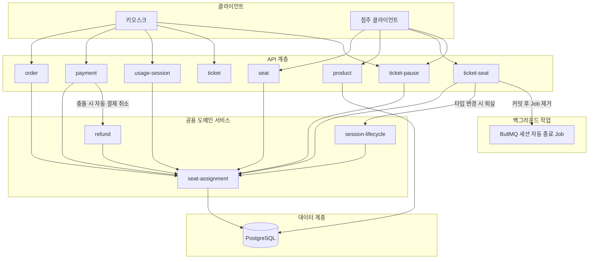
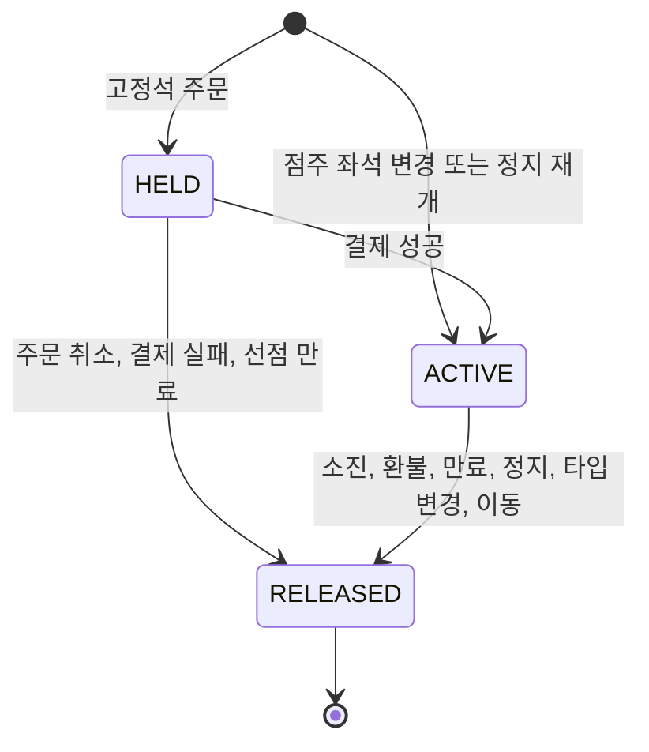
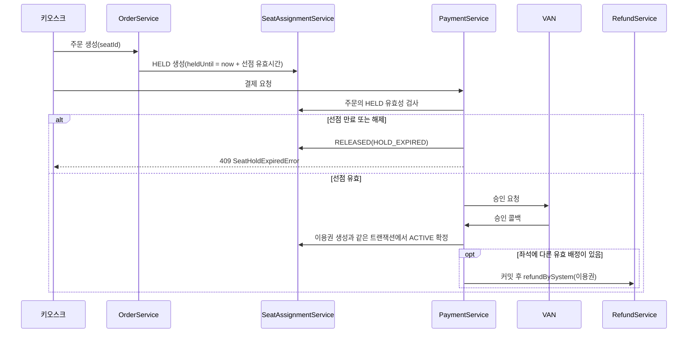
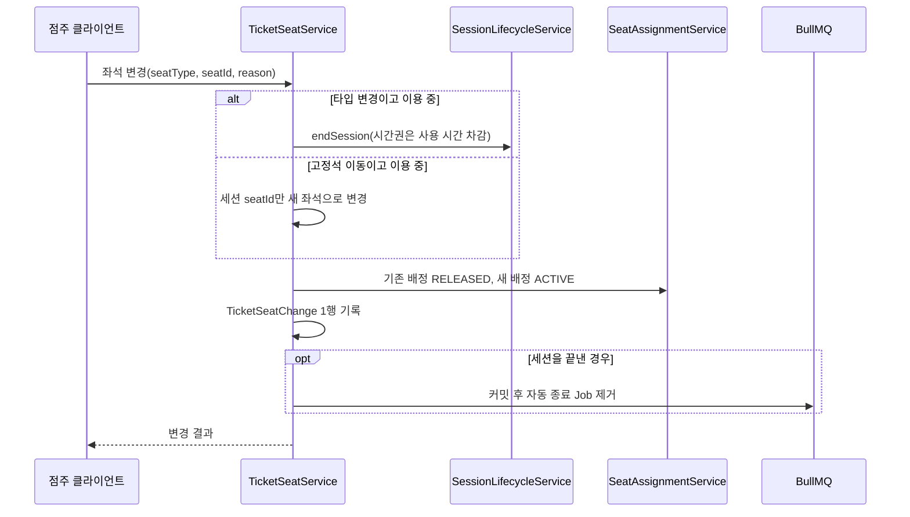

# 기술 설계: 구현 계획: 좌석 타입(고정석·자유석) 추가

**기능**: 구현 계획: 좌석 타입(고정석·자유석) 추가
**작성일**: 2026-10-25
**상태**: 초안

## 요약

좌석·상품·이용권에 좌석 타입(`FIXED`/`FREE`)을 붙이고, 고정석 배정은 새 테이블 `SeatAssignment`가 상태 전이로 관리한다. 배정은 주문 때 선점(HELD)되고, 결제 성공 때 확정(ACTIVE)되며, 종료·일시정지·좌석 변경 때 해제(RELEASED)된다. 좌석당 유효 배정 1개는 부분 유일 인덱스(partial unique index, 조건에 맞는 행끼리만 중복을 막는 인덱스)로 DB가 보장한다. 점주의 이용권 좌석 변경은 새 API와 이력 테이블 `TicketSeatChange`가 맡는다.

**현재 상태**: 좌석에는 타입이 없고, 이용권을 특정 좌석에 묶는 데이터도 없다.
**영향 계층**: API 계층, 도메인 서비스, 데이터 계층, 백그라운드 작업(BullMQ)
**제약**:

- 새 기술 도입 없음: NestJS, Prisma, PostgreSQL, Redis만 쓴다.
- 새 로직은 Controller → Service → Repository 3계층을 따른다.
- `@Global()`은 Prisma·Redis만, `seat-assignment`는 명시적으로 import한다.
- 이용권 만료 배치는 만들지 않는다(R3).
- 이용권 좌석 변경은 이용권 종류·잔여 시간·만료일을 바꾸지 않는다.
- 거부 사유마다 서로 다른 `error.code`를 쓴다(헌법 VI).
- 성능은 기존 API 수준을 유지한다. 배정 검증은 단건·인덱스 조회로 한다.

## 비기능 요구사항

| 품질 특성 (ISO 25010) | 목표 | 확인 방법 |
| --- | --- | --- |
| 신뢰성 | 같은 좌석 동시 주문 2건 중 성공은 1건 | 부분 유일 인덱스, E2E QS-8 |
| 기능 적합성 | 마이그레이션 후 기존 좌석·상품·이용권 100%가 `FREE` | 마이그레이션 직후 조회(SC-001) |
| 기능 적합성 | 방치된 선점은 10분 뒤 선택 가능(환경 변수 `SEAT_HOLD_MINUTES`) | E2E QS-25 |

## 아키텍처 접근

이 기능은 기존 단일 NestJS 백엔드의 도메인 모듈 구조 안에서 끝난다. 새 모듈은 두 개다. 좌석 배정을 맡는 `seat-assignment`와, `ticket` 아래의 이용권 좌석 변경 하위 모듈 `ticket-seat`이다. 나머지는 기존 모듈에 검증과 상태 전이를 더한다.

`seat-assignment`를 따로 둔 이유는 사용처가 많아서다. order, payment, ticket-seat, ticket-pause, usage-session, session-lifecycle, refund, seat가 모두 배정을 만들거나 풀거나 확인한다. 각 모듈은 이 모듈을 명시적으로 import한다. "유효한 배정" 판정은 순수 함수 하나(`seat-assignment.policy`)에만 둬서 모든 호출처가 같은 기준을 쓴다.

배정 해제는 두 방식으로 나뉜다. 이벤트가 있는 종료(시간권 소진, 환불 확정, 일시정지)는 그 상태 전이와 같은 트랜잭션에서 바로 푼다. 시간이 지나 의미상 끝나는 만료는 지연 해제한다. 누군가 그 좌석을 선점·재배정·이동하려 할 때 같은 트랜잭션에서 낡은 행을 `RELEASED`로 바꾼다. 좌석 목록의 `isAssignable`도 조회 시점에 같은 판정으로 다시 계산한다.

결제 쪽은 두 단계로 막는다. 결제 요청 때 주문의 HELD가 아직 유효한지 먼저 검사하고, 만료됐으면 409로 거부한다. 그래도 승인 콜백 전에 만료될 수 있으므로, 승인 후 좌석을 줄 수 없으면 이용권을 발급하고 커밋 후 기존 환불 경로로 자동 결제 취소한다. 이를 위해 `RefundService`에 시스템 호출용 `refundBySystem`을 두고 `RefundModule`이 서비스를 export한다.

이용 중인 이용권의 좌석을 바꿀 때는 기존 세션 종료 로직을 재사용한다. 타입 변경은 `SessionLifecycleService.endSession`으로 즉시 퇴실시키고, 커밋 후 BullMQ 자동 종료 Job을 제거한다. 고정석 간 이동은 세션을 끝내지 않고 세션의 `seatId`만 바꾼다. 좌석 자체 수정에는 가드를 둔다. 이용 중인 좌석과 유효 배정이 있는 고정석은 타입·상태 변경을 거부한다.



배정 한 건의 상태는 아래처럼 바뀐다. `RELEASED`가 된 행은 다시 쓰지 않고, 새 배정은 새 행으로 만든다.



## 영향 모듈

| 모듈 / 컴포넌트 | 변경 | 역할 |
| --- | --- | --- |
| `seat` | 변경 | 등록·수정에 `type`, 수정에 `status`, 이용 중·배정 가드 추가 |
| `product` | 변경 | 등록에 `seatType`, 수정 API 신규, 바뀐 필드를 `ProductHistory`에 기록 |
| `order` | 변경 | 주문 항목에 `seatId`, 고정석 검증과 HELD 선점, 주문 취소 API 신규 |
| `payment` | 변경 | 결제 요청 때 선점 검사, 콜백에서 확정·해제·자동 결제 취소 호출 |
| `ticket` | 변경 | 조회 결과에 `seatType`·`assignedSeat`, 이용권 오류 클래스 추가 |
| `ticket-seat` | 추가 | 이용권 좌석 변경 API와 변경 이력 조회 |
| `ticket-pause` | 변경 | 일시정지 때 배정 해제, 재개 때 고정석 재배정 |
| `usage-session` | 변경 | 입실 때 이용권 좌석 타입과 배정 좌석 검증 |
| `seat-assignment` | 추가 | 선점·확정·해제와 유효 배정 판정을 한 곳에서 담당 |
| `session-lifecycle` | 변경 | 시간권 소진(EXHAUSTED) 전이와 같은 트랜잭션에서 배정 해제 |
| `refund` | 변경 | 환불 확정 때 배정 해제, `refundBySystem` 추가와 서비스 export |
| `config` | 변경 | 선점 유효시간 `SEAT_HOLD_MINUTES`(기본 10분) 설정·검증 |
| Prisma 스키마·마이그레이션 | 변경 | enum·컬럼 추가, 새 테이블 2개, 부분 유일 인덱스 raw SQL |

## 데이터 설계

### 데이터 모델

```text
SeatType (enum): FIXED(고정석), FREE(자유석)
SeatAssignmentStatus (enum): HELD(주문 선점), ACTIVE(이용권 확정), RELEASED(해제)
SeatReleaseReason (enum): ORDER_CANCELLED, PAYMENT_FAILED, HOLD_EXPIRED,
  TICKET_EXPIRED, TICKET_EXHAUSTED, TICKET_REVOKED, TICKET_PAUSED,
  SEAT_TYPE_CHANGED, SEAT_MOVED
TicketSeatChangeType (enum): TYPE_CHANGE(고정석 ↔ 자유석), SEAT_MOVE(고정석 → 다른 고정석)

기존 모델에 추가 (모두 NOT NULL, DB 기본값 FREE는 기존 행 이전용)
- Seat.type: SeatType - 좌석 타입
- Product.seatType: SeatType - 상품 좌석 타입
- OrderItem.seatType: SeatType - 구매 시점 상품 좌석 타입 스냅샷
- Ticket.seatType: SeatType - 현재 좌석 타입, 점주 변경 때 갱신

SeatAssignment (좌석 배정, 한 행 = 좌석 1개와 이용권 또는 주문 항목 1개)
- seatId: 좌석 FK
- orderItemId: 주문 항목 FK, 구매로 생긴 배정일 때만 값이 있음
- ticketId: 이용권 FK, HELD 동안은 null
- status: SeatAssignmentStatus - 기본 HELD
- heldUntil: HELD 유효시간
- assignedAt / releasedAt: 확정 시각 / 해제 시각
- releaseReason: SeatReleaseReason
- 제약: seat_id 유일 (status가 HELD 또는 ACTIVE인 행끼리)
- 제약: ticket_id 유일 (status가 ACTIVE인 행끼리)
- 인덱스: (ticket_id, status), (order_item_id)

TicketSeatChange (이용권 좌석 변경 이력, 변경 1건 = 1행)
- ticketId: 대상 이용권 FK
- changeType: TicketSeatChangeType
- fromSeatType / toSeatType: 변경 전후 좌석 타입
- fromSeatId / toSeatId: 변경 전후 배정 좌석, 자유석 쪽은 null
- reason: 변경 사유, 필수, 최대 500자
- changedBy: 변경자 FK
- endedSessionId: 이 변경으로 끝난 이용 세션, 없으면 null
- changedAt: 변경 시각
- 인덱스: (ticket_id, changed_at)
```

"유효한 배정"은 두 경우다. `HELD`이고 `heldUntil`이 지금 이후이거나, `ACTIVE`이고 연결 이용권이 아직 만료되지 않은 경우다. 이용권 만료는 상태가 `UNUSED`/`ACTIVE`이고 기한 필드가 지금 이후인지로 본다. 기간권은 `expiresAt`(활성화 전이면 `activationDeadline`), 시간권은 `minuteExpireDeadline`을 쓴다.

### 데이터 흐름

구매 흐름에서 배정은 주문 트랜잭션에서 생기고, 결제 콜백 트랜잭션에서 확정된다. 승인 후 좌석을 줄 수 없으면 커밋이 끝난 뒤 자동 결제 취소가 따라간다.



승인 실패 콜백은 HELD를 `RELEASED(PAYMENT_FAILED)`로, 주문 취소는 `RELEASED(ORDER_CANCELLED)`로 바꾼다. 자동 결제 취소가 확정될 때까지 그 이용권은 배정 좌석 없이 `UNUSED`로 남고, 입실 검증이 사용을 막는다.

## API 설계

응답은 기존 `{ success, statusCode, data, timestamp, path }` 형식을 따른다. 오류의 `error.code`는 도메인 에러 클래스 이름이다.

```text
POST /shops/:shopId/seats            좌석 등록 (변경)
  Request:  type: FIXED | FREE (필수), name?, number?
  Errors:   400 DTO 검증 실패 (type 없음, 허용되지 않는 값)

PATCH /seats/:seatId                 좌석 수정 (변경)
  Request:  type?, status?: AVAILABLE | UNAVAILABLE
  Errors:   404 SeatNotFoundError
            409 SeatAlreadyOccupiedError: 이용 중인 좌석의 type·status 변경
            409 SeatHasAssignmentError: 유효 배정 있는 고정석을 FREE 또는 UNAVAILABLE로

GET /shops/:shopId/seats             좌석 목록 (변경)
  Response: 항목마다 type, isAssignable (자유석은 항상 false)

POST /shops/:shopId/products         상품 등록 (변경): seatType 필수
PATCH /shops/:shopId/products/:productId   상품 수정 (신규, OWNER·MANAGER)
  Request:  type(이용권 종류)을 뺀 필드를 모두 선택 입력
  Errors:   400 ProductFieldMismatchError, 404 ProductNotFoundError

POST /orders                         주문 생성 (변경)
  Request:  orderedProducts[]: { productId, quantity, seatId? }
  Errors:   400 SeatSelectionRequiredError, FixedSeatQuantityError,
                SeatNotAllowedError, SeatShopMismatchError, SeatTypeMismatchError
            409 SeatNotAssignableError, DuplicateSeatInOrderError

PATCH /orders/:orderId/cancel        주문 취소 (신규, 멱등)
  Errors:   404 OrderNotFoundError, 409 OrderAlreadyPaidError

POST /payments                       결제 요청 (동작 변경)
  Errors:   409 SeatHoldExpiredError

POST /usage-sessions                 입실 (동작 변경)
  Errors:   400 SeatTypeMismatchError, NotAssignedSeatError, TicketSeatUnassignedError

GET /tickets/:id                     이용권 조회 (변경)
  Response: seatType, assignedSeat: { id, number, name } | null

PATCH /tickets/:ticketId/seat        이용권 좌석 변경 (신규, OWNER·MANAGER)
  Request:  seatType (필수), seatId (FIXED이면 필수), reason (필수, 최대 500자)
  Errors:   400 SeatShopMismatchError, SeatTypeMismatchError, TicketSeatUnchangedError,
                TicketClosedError, TicketPausedError
            404 TicketNotFoundError, SeatNotFoundError
            409 SeatNotAssignableError, SeatAlreadyOccupiedError

GET /tickets/:ticketId/seat-changes  이용권 좌석 변경 이력 (신규, 최신순)

PATCH /tickets/:ticketId/resume      일시정지 재개 (변경)
  Request:  seatId? (고정석 이용권이면 필수)
  Errors:   400 SeatSelectionRequiredError, 409 SeatNotAssignableError (정지 유지)

PATCH /tickets/:ticketId/pause       일시정지 (동작 변경): 고정석이면 배정 해제
```

이용권 좌석 변경은 요청 하나 안에서 세 갈래로 나뉜다. 세션 처리와 Job 제거의 순서가 중요해서 아래에 따로 그린다.



## 명세 대응

| 사용 사례 | 컴포넌트 / 동작 | 비고 |
| --- | --- | --- |
| US1-1 고정석으로 좌석 등록 | `POST /shops/:shopId/seats` | QS-2 |
| US1-2 자유석을 고정석으로 수정 | `PATCH /seats/:seatId` | 이용 중이면 409 |
| US1-3 타입 없이 등록 거부 | `CreateSeatDto` 검증 | QS-1 |
| US2-1 고정석 시간권 구매 | `POST /orders` + 결제 콜백 확정 | QS-6 |
| US2-2 좌석 없이 고정석 구매 거부 | `OrderService` 검증 | `SeatSelectionRequiredError`, QS-4 |
| US2-3 자유석 기간권 좌석 없이 구매 | `POST /orders` | 기존 조회 오류로 시간권으로 검증(QS-10) |
| US2-4 이미 배정된 좌석 구매 거부 | `SeatAssignmentService` 판정 + 부분 유일 인덱스 | QS-7 |
| US2-5 자유석 좌석으로 고정석 구매 거부 | `OrderService` 검증 | `SeatTypeMismatchError`, QS-5 |
| US3-1 고정석 이용권으로 배정 좌석 입실 | `UsageSessionService.createSession` | QS-11 |
| US3-2 배정 좌석 외 입실 거부 | `UsageSessionService.createSession` | `NotAssignedSeatError` |
| US3-3 자유석 이용권으로 자유석 입실 | `UsageSessionService.createSession` | QS-12 |
| US3-4 자유석 이용권으로 고정석 입실 거부 | `UsageSessionService.createSession` | `SeatTypeMismatchError` |
| US4-1 자유석을 고정석으로 변경 | `PATCH /tickets/:ticketId/seat` | QS-13a |
| US4-2 좌석 없이 고정석 변경 거부 | `ChangeTicketSeatDto` 검증 | DTO 검증 400 |
| US4-3 고정석을 자유석으로 변경 | `TicketSeatService` | `SEAT_TYPE_CHANGED`, QS-14a |
| US4-4 다른 빈 고정석으로 이동 | `TicketSeatService` | `SEAT_MOVED`, QS-15a |
| US4-5 배정된 고정석·자유석으로 이동 거부 | `TicketSeatService` | QS-15b |
| US4-6 이용 중 이동 시 세션 유지 | `TicketSeatService` 세션 좌석 변경 | QS-15 |
| US4-7 이용 중 시간권 타입 변경 | `SessionLifecycleService.endSession` | 즉시 퇴실, QS-13 |
| US4-8 이용 중 기간권 타입 변경 | `SessionLifecycleService.endSession` | `expiresAt` 불변, QS-14 |
| 경계: 이용 중 좌석 타입 수정 거부 | `SeatService.updateSeat` | QS-26 |
| 경계: 뒤로 가기·방치 시 선점 해제 | `PATCH /orders/:orderId/cancel`, 지연 해제 | QS-24, QS-25 |
| 경계: 동시 구매 | 부분 유일 인덱스 | QS-8 |
| 경계: 선점 만료 후 결제 | 결제 요청 검사, 자동 결제 취소 | QS-30, QS-31 |
| 경계: 배정된 고정석을 자유석·이용 불가로 | `SeatService.updateSeat` | QS-23, QS-27 |
| 경계: 재개 때 배정할 고정석 없음 | `TicketPauseService.resumeTicket` | 정지 유지, QS-19 |
| 경계: 기존 데이터는 자유석 | 마이그레이션 DB 기본값 `FREE` | SC-001 |

## 주요 기술 결정

### 배정 저장 위치

**맥락**: 결제 전에 좌석을 선점해야 하고, 해제·재배정 이력이 남아야 한다.
**검토한 선택지**:

- 새 테이블 `SeatAssignment`: 선점과 이력을 표현할 수 있다.
- `Ticket.assignedSeatId` 컬럼: 주문 단계 선점을 표현 못 한다.

**결정**: 새 테이블에 상태 전이로 저장하고, 부분 유일 인덱스로 유효 배정 1개를 보장한다. 기존 `UsageSession`, `TicketPause`와 같은 방식이다.
**결과**:

- 장점: 선점부터 해제까지 한 행에 이력이 남는다.
- 단점: 배정 여부를 볼 때마다 조인과 판정이 필요하다.

### 선점 시점

**맥락**: 결제 성공 때만 검사하면 두 명이 같은 좌석을 결제한 뒤에야 충돌을 안다.
**검토한 선택지**:

- 주문 생성 때 HELD 선점: 좌석 예약 업계의 일반 방식이다.
- 결제 성공 때 검사, 충돌 시 PG 승인 취소: 환불까지 엮인다.

**결정**: 주문 생성 때 HELD로 선점하고 결제 성공 때 확정한다. 취소는 즉시, 방치는 10분 뒤 풀린다(2026-10-21 사용자 확인).
**결과**:

- 장점: 동시 구매는 먼저 주문한 한 건만 성공한다.
- 단점: 주문 취소 API를 새로 만들어야 한다.

### 시간 경과형 만료의 해제 방식

**맥락**: 현재 코드에는 이용권이 `EXPIRED`로 바뀌는 이벤트가 없다.
**검토한 선택지**:

- 지연 해제: 그 좌석을 다시 쓸 때 낡은 배정을 푼다.
- BullMQ 만료 Job이나 주기 배치: 별도 기능이라 범위 밖이다.

**결정**: 지연 해제를 쓰고, 조회 때도 같은 판정으로 `isAssignable`을 계산한다(2026-10-21 사용자 확인).
**결과**:

- 장점: 만료 직후 다른 이용자가 그 좌석을 고를 수 있다.
- 단점: DB 행 상태와 실제 유효 여부가 잠시 다를 수 있다.

### 고정석 상품 주문 수량

**맥락**: 기존 주문 항목은 수량만큼 이용권을 만든다.
**검토한 선택지**:

- 줄마다 `quantity = 1`과 `seatId` 하나: 검증이 단순하다.
- `seatIds` 배열(길이 = 수량): DTO 검증이 복잡해진다.

**결정**: 고정석 줄은 수량 1과 좌석 1개로 받는다. 2장이면 줄 2개를 보낸다(2026-10-21 사용자 확인).
**결과**:

- 장점: 이용권 하나에 좌석 하나라는 규칙과 맞는다.
- 단점: 여러 장 구매 때 요청 줄이 늘어난다.

### 고정석 이동 중 세션 처리

**맥락**: 이용 중 이동은 이용 상태를 유지해야 한다(FR-015b).
**검토한 선택지**:

- 세션 `seatId`만 바꾸기: 시작 시각, 종료 예정 시각, Job이 그대로다.
- 세션 종료 후 재생성: 잔여시간 차감과 퇴실·입실 기록이 생긴다.

**결정**: 활성 세션의 `seatId`만 새 좌석으로 바꾸고, 같은 트랜잭션에서 배정을 옮긴다.
**결과**:

- 장점: 이용자 시간과 자동 종료 일정이 바뀌지 않는다.
- 단점: 세션 좌석이 바뀐 사실은 세션 기록에 남지 않는다.

### 변경 이력 저장 방식

**맥락**: 변경자, 시각, 전후 타입·좌석, 사유를 기록해야 한다(FR-021).
**검토한 선택지**:

- 변경 1건당 1행인 `TicketSeatChange`: 항목이 고정돼 조회가 단순하다.
- `ProductHistory`식 필드 단위 기록: 범용이지만 조회가 복잡하다.

**결정**: 행 단위 테이블 `TicketSeatChange`를 새로 만든다.
**결과**:

- 장점: 이용권별 이력 조회가 인덱스 하나로 끝난다.
- 단점: 기록 항목이 늘면 컬럼을 추가해야 한다.

### 승인 후 좌석 충돌 처리

**맥락**: 선점이 만료된 뒤 승인 콜백이 오면 돈은 받았는데 좌석을 줄 수 없다.
**검토한 선택지**:

- 결제 요청 때 HELD 사전 검사: 대부분 막지만 0건은 아니다.
- 승인 후 충돌 시 자동 결제 취소: 기존 환불 경로를 쓴다.

**결정**: 두 방식을 함께 쓴다. 자동 결제 취소는 `refundBySystem`이 기존 `processAutoRefund`를 시스템 주체로 호출한다(2026-10-21 사용자 확인).
**결과**:

- 장점: `RefundLock`·`PaymentCancel` 처리가 일반 환불과 같다.
- 단점: 취소 확정 전까지 배정 없는 `UNUSED` 이용권이 잠시 존재한다.

## 테스트 전략

- **단위**: 배정 판정 함수, 서비스별 검증과 상태 전이 규칙.
- **통합**: 원본에 명시되지 않음. 모듈 간 흐름은 E2E가 맡는다.
- **E2E / BDD**: quickstart QS-1~31, 거부 시나리오는 `error.code`까지 검증.
- **관측성**: 자동 결제 취소 실패는 거래 로그에 남겨 운영자가 확인.

테스트는 동작 하나씩 실패 사유를 확인한 뒤 구현한다(헌법 III). 입실 규칙, 이용권 좌석 변경, 배정 상태 변화는 경우의 수 표로 모든 칸을 QS 번호나 단위 테스트에 묶는다.

## 배포와 이전

**전략**: 원본에 명시되지 않음.
**데이터 이전**: 마이그레이션 하나로 `seats.type`, `products.seat_type`, `order_items.seat_type`, `tickets.seat_type`을 `NOT NULL DEFAULT 'FREE'`로 추가한다. 기존 행은 모두 자유석이 되고 배정 행은 만들지 않는다. 부분 유일 인덱스는 raw SQL로 만든다.
**되돌리기**: 원본에 명시되지 않음.

## 위험과 대응

**만료 판정 불일치**

- **잘못될 수 있는 일**: 호출처마다 판정이 다르면 좌석 표시와 거부가 어긋난다.
- **가능성**: 보통
- **영향**: 높음
- **대응**: 판정은 `seat-assignment.policy` 순수 함수 한 곳에만 두고 모든 곳이 쓴다.

**자동 결제 취소의 응답 없는 실패**

- **잘못될 수 있는 일**: PG 취소 무응답이면 `PaymentCancel`이 `REQUESTED`로 정리되지 않고 남는다.
- **가능성**: 낮음
- **영향**: 높음
- **대응**: 거래 로그로 운영자가 확인한다. 자동 재시도는 후속 과제(`docs/TODO.md` 환불 미완료 9번)다.

**배정 없는 고정석 이용권**

- **잘못될 수 있는 일**: 취소 확정 전, 배정 없는 고정석 이용권이 남는다.
- **가능성**: 낮음
- **영향**: 보통
- **대응**: 입실 검증이 배정 좌석 없는 고정석 이용권을 `TicketSeatUnassignedError`로 거부한다.
