# 환불 인수 시나리오 다이어그램

**갱신일**: 2026-10-27 · **기준**: [기능 명세](spec.md), 정책 v0.4

92개 인수 시나리오마다 독립된 Mermaid 다이어그램을 둔다. 번호는 사용자 스토리-시나리오 번호다. 예를 들어 2-3a는 스토리 2의 3a에 대응한다.

정상 환불 요청은 해당 금액과 이용 종료 유지에 필요한 동의를 받은 경우다. 신청 거절과 접수 후 PG 취소 요청 실패를 구분한다. 업무 결정은 기능 명세가 기준이다.

PG 취소 요청은 서버가 PG에 확정된 환불 금액만큼 결제를 취소해 달라고 보내는 요청이다. 서버는 PG 취소 요청 식별자(`PaymentCancel.id`)를 발급해 각 요청의 금액과 처리 결과를 기록한다.

PG 취소 요청 식별자(`PaymentCancel.id`)는 환불 건의 식별자(`Refund.id`), 화면에서 보내는 요청 키(`Idempotency-Key`), PG가 응답하는 거래 식별자(`pgTransactionId`)와 구분한다.

거절 확정은 PG가 해당 요청을 거절했고 그 요청으로 취소가 실행되지 않았으며 앞으로도 진행되지 않는다고 확정 응답한 경우다. 오류 문자열만으로 실행 여부가 불명확하면 거절 확정이 아니다.

- **기존 요청 재전송**: 처리 결과가 아직 확정되지 않은 취소 요청을 기존 PG 취소 요청 식별자와 금액으로 다시 보내는 것이다. `PaymentCancel` 기록을 추가하지 않는다. PG 미접수가 확실히 확인된 경우에만 보낸다.
- **새 식별자를 발급한 PG 취소 요청**: 실패한 요청을 대신하기 위해 서버가 새로운 PG 취소 요청 식별자(`PaymentCancel.id`)를 발급해 보내는 요청이다. 기존 환불(`Refund`)과 확정된 환불 금액은 유지하고, 이전 실패 기록을 보존한 채 `PaymentCancel` 기록을 하나 추가한다.

## 목차

- [사용자 스토리 1: 고객이 환불을 신청하고 정책서 순서대로 판정받는다](#story-1)
- [사용자 스토리 2: 점주가 매장 환불을 한다](#story-2)
- [사용자 스토리 3: 환불 확정으로 이용이 종료된 이용권은 다시 입실할 수 없다](#story-3)
- [사용자 스토리 4: 실제 지급이 확인되면 정산 원장에 환불금 지급 기록이 남는다](#story-4)
- [사용자 스토리 5: 미지급 환불금을 조회·재전송·운영자 대응으로 처리한다](#story-5)
- [사용자 스토리 6: 결제 승인 금액이 맞지 않으면 승인을 취소한다](#story-6)
- [사용자 스토리 7: PG 콜백은 PG만 보낼 수 있다](#story-7)
- [사용자 스토리 8: 환불 내역은 권한이 있는 사람만 조회한다](#story-8)
- [사용자 스토리 9: 점주와 고객이 환불 결과를 알 수 있다](#story-9)
- [사용자 스토리 10: 점주와 운영자가 미지급 환불금을 재처리한다](#story-10)

<a id="story-1"></a>

## 사용자 스토리 1: 고객이 환불을 신청하고 정책서 순서대로 판정받는다

<a id="scenario-1-1"></a>

### 1-1. 미사용 이용권의 종료와 전액 환불 확정

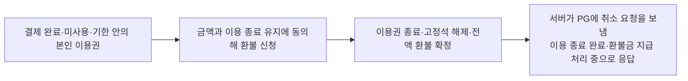

<a id="scenario-1-1a"></a>

### 1-1a. 종료와 금액 동의 없는 신청 거절

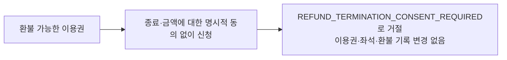

<a id="scenario-1-2"></a>

### 1-2. 다른 고객의 이용권 환불 거절

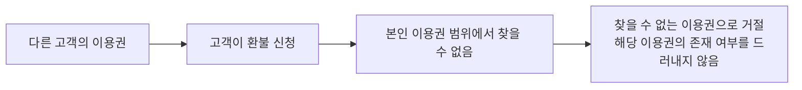

<a id="scenario-1-3"></a>

### 1-3. 결제 미완료 이용권 환불 거절


<a id="scenario-1-4"></a>

### 1-4. 환불금 지급 완료된 이용권의 새 환불 거절

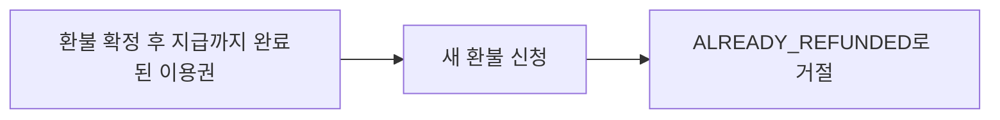

<a id="scenario-1-5"></a>

### 1-5. 확정 미지급 환불의 새 신청 거절

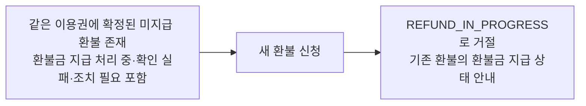

<a id="scenario-1-6"></a>

### 1-6. 사용 이력이 있는 이용권의 고객 환불 거절

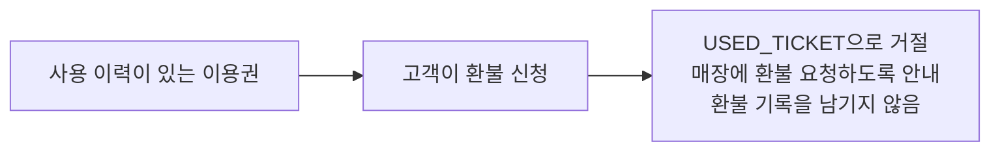

<a id="scenario-1-7"></a>

### 1-7. 현재 이용 중인 이용권의 고객 환불 거절


<a id="scenario-1-8"></a>

### 1-8. 이용 기한이 지난 미사용 이용권의 고객 환불 거절

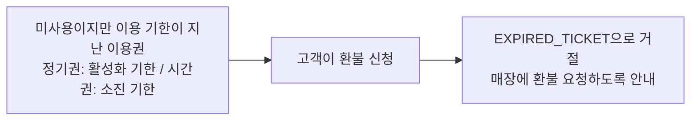

<a id="scenario-1-9"></a>

### 1-9. 사용 이력보다 기존 미지급 환불을 먼저 판정

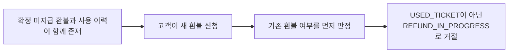

<a id="story-2"></a>

## 사용자 스토리 2: 점주가 매장 환불을 한다

<a id="scenario-2-1"></a>

### 2-1. 매장 환불 확정과 이용 종료

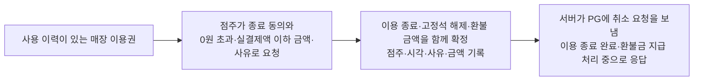

<a id="scenario-2-2"></a>

### 2-2. 매장 환불금 지급 완료

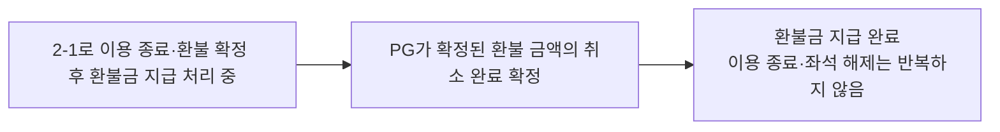

<a id="scenario-2-3"></a>

### 2-3. 기한이 지난 미사용 이용권의 매장 환불: 전액 강제 없음

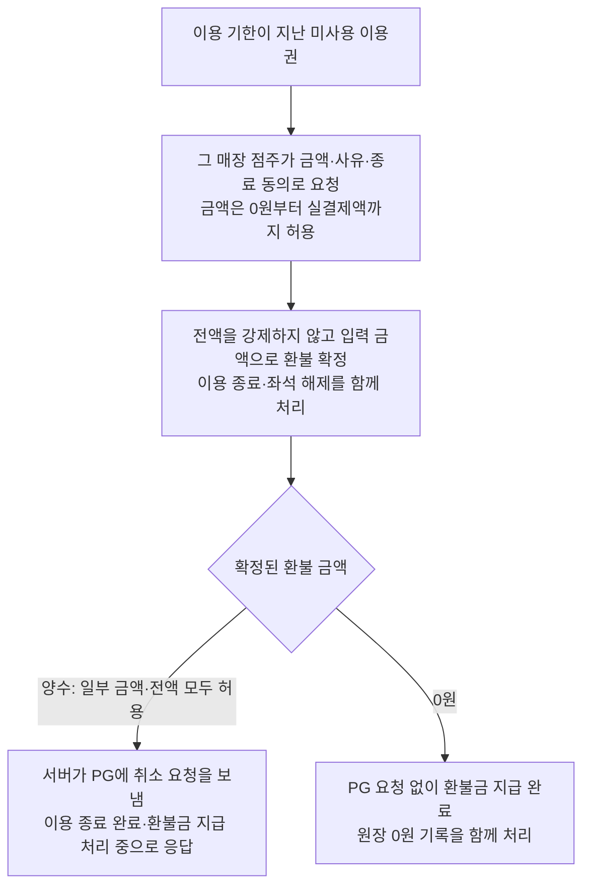

<a id="scenario-2-3a"></a>

### 2-3a. 시간을 다 쓴 시간권의 매장 환불

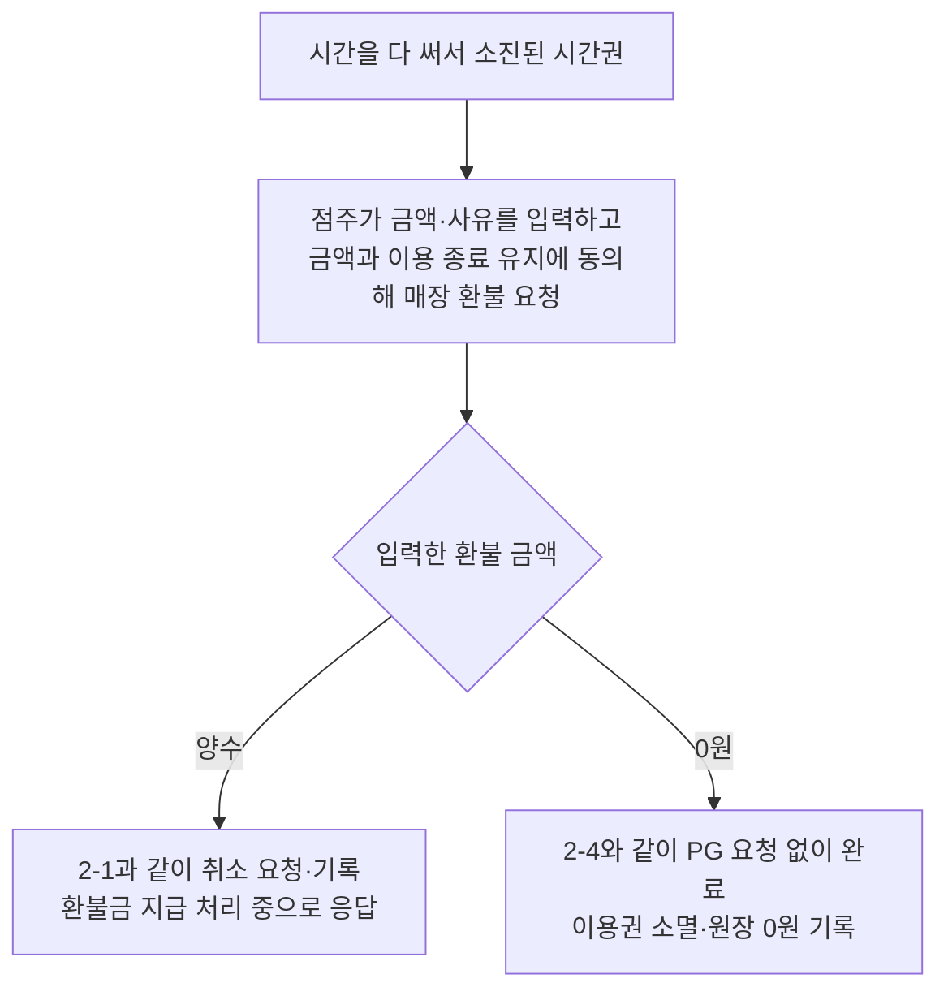

<a id="scenario-2-4"></a>

### 2-4. 0원 환불의 종료와 환불금 지급 완료

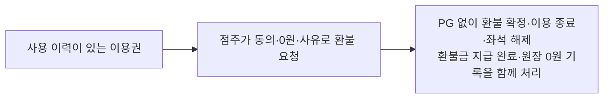

<a id="scenario-2-5"></a>

### 2-5. 실결제액을 넘는 매장 환불 거부


<a id="scenario-2-6"></a>

### 2-6. 사유 없는 매장 환불 거부


<a id="scenario-2-7"></a>

### 2-7. 다른 매장 이용권의 매장 환불 거부

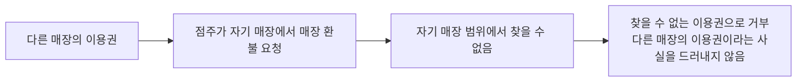

<a id="scenario-2-7a"></a>

### 2-7a. 고객지원 계정의 매장 환불 거부


<a id="scenario-2-8"></a>

### 2-8. 기한 안 미사용 이용권의 매장 전액 환불 확정

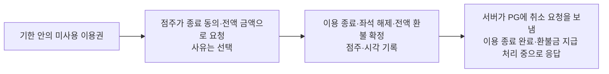

<a id="scenario-2-8a"></a>

### 2-8a. 기한 안 미사용 이용권의 전액 외 금액 환불 거부

```mermaid
flowchart LR
    n0["이용 기한 안의 미사용 이용권"]
    n1["점주가 실결제액과 다른 금액으로 요청"]
    n2["이용 기한 안의 미사용 이용권은 실결제액 전액만 환불 가능하므로 거부<br/>이용권·결제에 변화 없음"]
    n0 --> n1
    n1 --> n2
```

<a id="scenario-2-9"></a>

### 2-9. 기존 확정 환불이 있는 이용권의 새 매장 환불 거절

```mermaid
flowchart TD
    request["점주가 새 매장 환불 신청"] --> state{"기존 확정 환불의 환불금 지급 상태"}
    state -->|환불금 지급 완료| paid["ALREADY_REFUNDED로 거절"]
    state -->|미지급| unpaid["REFUND_IN_PROGRESS로 거절<br/>기존 환불에서 지급 처리"]
```

<a id="scenario-2-10"></a>

### 2-10. 이용 중인 이용권의 퇴실 동의 없는 환불 거부

```mermaid
flowchart LR
    n0["고객이 해당 이용권으로 이용 중"]
    n1["점주가 퇴실 동의 없이 매장 환불 요청"]
    n2["이용 중 오류로 거부<br/>이용·이용권에 변화 없음"]
    n0 --> n1
    n1 --> n2
```

<a id="scenario-2-11"></a>

### 2-11. 퇴실 동의 후 이용 종료·환불 확정

```mermaid
flowchart LR
    n0["고객이 해당 이용권으로 이용 중"]
    n1["점주가 종료·퇴실 동의를 담아 요청"]
    n2["퇴실·시간권 사용량 차감·이용권 종료<br/>고정석 해제·환불 확정을 함께 처리"]
    n3["서버가 PG에 취소 요청을 보냄<br/>이용 종료 완료·환불금 지급 처리 중으로 응답"]
    n0 --> n1
    n1 --> n2
    n2 --> n3
```

<a id="scenario-2-12"></a>

### 2-12. 퇴실 동의가 있어도 금액 검증 실패 시 퇴실하지 않음

```mermaid
flowchart LR
    n0["고객이 이용 중"]
    n1["점주가 퇴실에 동의했지만<br/>실결제액보다 큰 금액으로 요청"]
    n2["환불 거부<br/>퇴실하지 않음"]
    n0 --> n1
    n1 --> n2
```

<a id="scenario-2-13"></a>

### 2-13. PG 결제 취소 실패에도 이용 종료 유지

```mermaid
flowchart LR
    n0["2-11로 이용 종료·좌석 해제·환불 확정"]
    n1["PG가 취소 실패 확정"]
    n2["PG 취소 요청 실패·미지급 조치 필요 기록·알림"]
    n3["이용권·좌석·퇴실·사용량 차감 유지<br/>새 환불 대신 같은 환불의 지급 재처리"]
    n0 --> n1
    n1 --> n2
    n2 --> n3
```

<a id="story-3"></a>

## 사용자 스토리 3: 환불 확정으로 이용이 종료된 이용권은 다시 입실할 수 없다

<a id="scenario-3-1"></a>

### 3-1. 환불금 지급 완료 후 종료 이용권 입실 거부

```mermaid
flowchart LR
    n0["환불 확정으로 이용 종료·환불금 지급 완료"]
    n1["입실 시도"]
    n2["TICKET_TERMINATED로 거부"]
    n0 --> n1
    n1 --> n2
```

<a id="scenario-3-2"></a>

### 3-2. 환불금 지급 처리 중·확인 실패에도 종료 이용권 입실 거부

```mermaid
flowchart LR
    n0["환불 확정으로 이용 종료<br/>환불금 지급 처리 중 또는 확인 실패"]
    n1["입실 시도"]
    n2["환불금 지급 완료 여부와 관계없이<br/>TICKET_TERMINATED로 거부"]
    n0 --> n1
    n1 --> n2
```

<a id="scenario-3-3"></a>

### 3-3. PG 결제 취소 실패 후에도 입실 거부

```mermaid
flowchart LR
    n0["환불 확정 후 PG 취소 요청 실패"]
    n1["입실 시도"]
    n2["TICKET_TERMINATED로 거부<br/>이용권·고정석 복구 없음"]
    n0 --> n1
    n1 --> n2
```

<a id="story-4"></a>

## 사용자 스토리 4: 실제 지급이 확인되면 정산 원장에 환불금 지급 기록이 남는다

<a id="scenario-4-1"></a>

### 4-1. 실제 PG 결제 취소 확인 시 원장 기록

```mermaid
flowchart LR
    n0["환불 확정 후 PG 취소 결과를 기다리는 중"]
    n1["PG가 실제 취소 금액 확정"]
    n2["해당 매장·주문에<br/>실제액의 음수 원장 1건 기록"]
    n0 --> n1
    n1 --> n2
```

<a id="scenario-4-2"></a>

### 4-2. 같은 지급의 중복 확정에도 원장 1건

```mermaid
flowchart LR
    n0["4-1의 같은 PG 결제 취소와 원장 1건 존재"]
    n1["같은 콜백 또는 거래조회 결과 반복"]
    n2["실제 환불금 지급액 중복 합산 없음<br/>같은 지급 원장은 1건 유지"]
    n0 --> n1
    n1 --> n2
```

<a id="scenario-4-3"></a>

### 4-3. 실패한 PG 취소 요청은 원장에 기록하지 않음

```mermaid
flowchart LR
    n0["PG 취소 결과를 기다리는 중"]
    n1["PG가 취소 요청을 거절했다고 확정"]
    n2["실패 시도의 원장 기록 없음"]
    n0 --> n1
    n1 --> n2
```

<a id="scenario-4-4"></a>

### 4-4. 미확정 환불금 지급은 원장에 기록하지 않음

```mermaid
flowchart LR
    n0["환불금 지급 처리 중 또는 PG 취소 결과 확인 실패"]
    n1["환불금 지급 결과가 아직 미확정"]
    n2["실제 지급 원장 생성 안 함"]
    n0 --> n1
    n1 --> n2
```

<a id="story-5"></a>

## 사용자 스토리 5: 미지급 환불금을 조회·재전송·운영자 대응으로 처리한다

<a id="scenario-5-1"></a>

### 5-1. 전송 전 실패는 미지급 조치 필요

```mermaid
flowchart LR
    n0["이용 종료·환불 금액 확정"]
    n1["PG 요청 전송 전 실패가 확실함"]
    n2["시도 실패·환불금 지급 조치 필요 기록<br/>운영자 알림"]
    n3["이용 종료·환불 금액 유지<br/>응답에 종료와 미지급 상태 구분"]
    n0 --> n1
    n1 --> n2
    n2 --> n3
```

<a id="scenario-5-2"></a>

### 5-2. 조회로 확정된 환불 금액의 지급 완료 확인

```mermaid
flowchart LR
    n0["PG 응답 없음으로 환불금 지급 처리 중"]
    n1["정해진 시간 후 PG 조회에서<br/>확정된 환불 금액 취소 완료 확인"]
    n2["환불금 지급 완료·실제 금액 원장 함께 기록<br/>이용 종료·좌석 해제 반복 없음"]
    n0 --> n1
    n1 --> n2
```

<a id="scenario-5-3"></a>

### 5-3. PG 거절 뒤에도 환불금 유지

```mermaid
flowchart LR
    n0["PG 응답 없음으로 환불금 지급 처리 중"]
    n1["거래조회에서 PG 거절 확인"]
    n2["PG 취소 요청 실패·조치 필요 기록·알림"]
    n3["확정된 환불 금액·이용 종료 유지"]
    n0 --> n1
    n1 --> n2
    n2 --> n3
```

<a id="scenario-5-4"></a>

### 5-4. 고객·매장 환불의 미접수 확인 후 재전송

```mermaid
flowchart LR
    n0["고객·매장 환불의 PG 응답 없음"]
    n1["PG 미접수 확정·재전송 한도 남음"]
    n2["같은 환불·같은 금액으로 기존 요청 재전송<br/>기존 PG 취소 요청 식별자 유지·기록 추가 없음"]
    n3["환불금 지급 처리 중 유지"]
    n0 --> n1
    n1 --> n2
    n2 --> n3
```

<a id="scenario-5-5"></a>

### 5-5. 시스템 자동 취소에도 같은 재전송 규칙 적용

```mermaid
flowchart LR
    n0["시스템 자동 취소의 PG 응답 없음"]
    n1["PG 미접수 확정·재전송 한도 남음"]
    n2["5-4와 같은 규칙으로 재전송"]
    n3["환불금 지급 처리 중 유지"]
    n0 --> n1
    n1 --> n2
    n2 --> n3
```

<a id="scenario-5-6"></a>

### 5-6. 재전송 한도 소진·PG 미접수 확인 후 운영자 처리 대기

```mermaid
flowchart TD
    n0["자동 재전송 한도를 모두 소진"]
    n1["한도 횟수까지 보낸 취소 요청의<br/>PG 미접수를 거래조회로 확인"]
    n2["해당 PG 취소 요청을 FAILED로 기록<br/>실패 사유: RETRY_EXHAUSTED"]
    n3["이 시도는 자동 조회·재전송에서 제외"]
    n4["환불 건은 ACTION_REQUIRED로 기록<br/>운영자가 지급 재처리 방법을 결정하도록 알림"]
    n5["확정된 환불 금액·이용 종료 유지<br/>점주·운영자의 개별 확인 후 재전송은 10-1a<br/>운영자 직접 재시도는 10-1<br/>별도 환불금 지급은 10-3~10-4"]
    n0 --> n1
    n1 --> n2
    n2 --> n3
    n3 --> n4
    n4 --> n5
```

재전송 한도를 소진했더라도 PG 처리 중이거나 조회 자체가 실패하면 이 실패 전이를 적용하지 않는다. 결과가 확인될 때까지 5-7~5-10의 조회 규칙을 따른다.

<a id="scenario-5-7"></a>

### 5-7. PG 조회 자체 실패와 추가 환불금 지급 차단

```mermaid
flowchart LR
    n0["PG 결제 취소 결과 미확정"]
    n1["거래조회 자체 실패"]
    n2["성공·실패로 단정하지 않고 재조회"]
    n3["새 식별자를 발급한 PG 취소 요청·별도 환불금 지급 차단 유지"]
    n0 --> n1
    n1 --> n2
    n2 --> n3
```

<a id="scenario-5-8"></a>

### 5-8. 연속 조회 오류 한도 도달

```mermaid
flowchart LR
    n0["PG 거래조회 연속 실패"]
    n1["정해진 오류 횟수 도달"]
    n2["PG 취소 결과 확인 실패 표시·운영자 알림"]
    n3["미지급·결과 확인 중 유지<br/>이용 종료 유지"]
    n0 --> n1
    n1 --> n2
    n2 --> n3
```

<a id="scenario-5-9"></a>

### 5-9. 오래된 PG 취소 결과 확인 실패 1건 조회

```mermaid
flowchart LR
    n0["PG 취소 결과 확인 실패 여러 건 존재"]
    n1["자동 재확인 시점 도달"]
    n2["가장 오래된 1건만 PG 조회<br/>해당 시점의 자동 조회는 전체에서 1회"]
    n0 --> n1
    n1 --> n2
```

<a id="scenario-5-10"></a>

### 5-10. 정상 응답 후 나머지 미확정 건 재조회

```mermaid
flowchart TD
    first["5-9의 1건 조회"] -->|PG 정상 응답| apply["결과 반영·나머지를 정해진 건수씩 조회"]
    apply --> result{"각 PG 취소 요청의 결과"}
    result -->|정상 금액 완료| paid["환불금 지급 완료·실제액 원장"]
    result -->|거절| failed["시도 실패·미지급 조치 필요"]
    result -->|미접수 확정| resend["한도에 따라 재전송 또는 조치 필요"]
    result -->|처리 중·조회 장애| unknown["환불금 지급 여부 미확정 유지·재확인<br/>다른 환불금 지급 차단"]
```

<a id="scenario-5-10a"></a>

### 5-10a. 운영자가 전체 PG 재확인 즉시 실행

```mermaid
flowchart LR
    n0["PG 취소 결과 확인 실패 건 존재"]
    n1["운영자(고객지원 계정)가 전체 재확인 실행"]
    n2["자동 재확인 예정 시각을 기다리지 않고<br/>PG 취소 결과 확인 실패 건을 정해진 건수씩 묶어 조회"]
    n3["재조회 실행 자체는 환불 확정이나 환불금 지급 완료가 아님"]
    n0 --> n1
    n1 --> n2
    n2 --> n3
```

<a id="scenario-5-10b"></a>

### 5-10b. 운영 권한 없는 전체 PG 재확인 거절

```mermaid
flowchart LR
    n0["고객지원 계정이 아닌 사용자"]
    n1["PG 취소 결과 확인 실패 건의 전체 재확인 실행"]
    n2["REFUND_FORBIDDEN으로 거부"]
    n0 --> n1
    n1 --> n2
```

<a id="scenario-5-11"></a>

### 5-11. PG 실제 취소액 불일치 처리

```mermaid
flowchart LR
    n0["확정된 환불 금액의 PG 취소 요청"]
    n1["PG가 다른 금액의 취소 완료 통보"]
    n2["실제 환불금 지급액·원장 기록<br/>확정된 환불 금액은 불변"]
    n3["부족액·초과액을 분리해 조치 필요<br/>운영자 알림"]
    n0 --> n1
    n1 --> n2
    n2 --> n3
```

<a id="scenario-5-12"></a>

### 5-12. 시스템 취소의 결과 미수신

```mermaid
flowchart LR
    n0["시스템 자동 취소의 환불금 지급 결과 없음"]
    n1["5-2~5-11의 공통 조회·재전송 규칙 적용"]
    n2["같은 환불의 미지급 계속 관리<br/>승인액 불일치는 이용권 미발행"]
    n0 --> n1
    n1 --> n2
```

<a id="scenario-5-13"></a>

### 5-13. 점주·운영자의 개별 환불 즉시 확인

```mermaid
flowchart TD
    n0["조회 권한이 있는 점주 또는 운영자"]
    n1["환불 한 건의 PG 처리 결과 확인 실행"]
    n2["자동 예정 시각을 기다리지 않고<br/>해당 미확정 시도만 PG 조회"]
    n3["확정된 환불 금액과 같은 PG 취소 완료 확인<br/>지급 완료·실제액·원장을 한 번 반영한 뒤 결과 표시"]
    n0 --> n1
    n1 --> n2
    n2 --> n3
```

<a id="scenario-5-14"></a>

### 5-14. 개별 확인에서 PG 처리 중·조회 실패 안내

```mermaid
flowchart TD
    n0["결과가 미확정인 PG 취소 요청의 개별 확인 실행"]
    n1["PG 처리 중 또는 거래조회 실패"]
    n2["처리 중 또는 결과 확인 불가 안내<br/>환불금 지급 여부 미확정·다른 환불금 지급 차단 유지"]
    n3["기존 일정·오류 규칙으로 다시 확인"]
    n0 --> n1
    n1 --> n2
    n2 --> n3
```

<a id="scenario-5-15"></a>

### 5-15. 자동 작업과 개별 확인의 중복 호출 방지

```mermaid
flowchart TD
    n0["동일 시도의 전송·조회 작업 진행 중"]
    n1["점주 또는 운영자가 개별 확인 실행"]
    n2["진행 중 작업·현재 저장 상태 안내<br/>PG 추가 호출 없음"]
    n3["환불 상세에서 반영 결과 확인"]
    n0 --> n1
    n1 --> n2
    n2 --> n3
```

<a id="scenario-5-16"></a>

### 5-16. 개별 확인은 전체 재확인을 시작하지 않음

```mermaid
flowchart TD
    n0["PG 취소 결과 확인 실패 여러 건 존재"]
    n1["특정 환불 한 건만 개별 확인"]
    n2["해당 환불의 PG 결과만 반영"]
    n3["나머지 일괄 조회 시작 없음<br/>전체 복구 모드·예정 시각 유지"]
    n0 --> n1
    n1 --> n2
    n2 --> n3
```

<a id="scenario-5-17"></a>

### 5-17. 개별 PG 확인의 매장·역할 권한 검사

```mermaid
flowchart TD
    n0["다른 매장 점주·일반 고객·미로그인 사용자"]
    n1["개별 PG 확인 실행"]
    n2["매장 범위 밖 404·고객 403·미로그인 401"]
    n3["PG 호출·환불 상태 변경 없음"]
    n0 --> n1
    n1 --> n2
    n2 --> n3
```

<a id="scenario-5-18"></a>

### 5-18. PG 처리 결과 확인을 실행했지만 추가 조회가 필요 없는 경우

```mermaid
flowchart TD
    n0["해당 매장 점주 또는 운영자가<br/>환불 상세에서 PG 처리 결과 확인 실행"]
    n1{"확인한 환불의 상태"}
    n2["PG 취소 완료·금액 불일치 검토"]
    n3["0원 환불이므로 PG 취소 요청 없음"]
    n4["PG 추가 호출 없이 저장된 상태 안내"]
    n5["별도 지급 예약과 기존 실패 이력은 변경하지 않음"]
    n6["활성 별도 지급 예약 또는 MANUAL 방식"]
    n0 --> n1
    n1 -->|취소 완료·검토 대상| n2
    n1 -->|0원| n3
    n1 -->|별도 지급| n6
    n2 --> n4
    n3 --> n4
    n6 --> n4
    n4 --> n5
```

한도 소진·전송 전 실패·PG 거절로 최근 시도가 이미 실패한 건은 PG 방식·실제 지급액 0 등 재전송 허용 조건을 확인한 뒤 5-19·10-1a로 처리한다. 그 밖의 확정 실패는 PG 호출 없이 저장 상태와 운영자 조치를 안내한다.

<a id="scenario-5-19"></a>

### 5-19. 개별 확인에서 미접수 또는 거절 확정이 확인되면 횟수와 관계없이 다시 보낸다

점주 또는 운영자가 선택한 환불을 개별 확인하는 경우다. 미확정 시도의 확실한 미접수는 기존 요청을 재전송한다. 최근 시도가 이미 한도 소진·전송 전 실패·PG 거절로 FAILED이면 미접수 또는 거절 확정 후 새 요청을 보낸다. 자동 재전송 횟수로 제한하지 않는다. 미확정 요청의 조회에서 거절이 새로 확인되면 실패·조치 필요만 기록한다. 조회 오류나 PG 처리 중이라는 응답만으로 다시 보내지는 않는다.

```mermaid
flowchart TD
    n0["점주 또는 운영자가 환불을 선택하고<br/>PG 처리 결과 확인을 실행한다"]
    n1["미확정 시도의 PG 미접수 또는<br/>이미 실패한 시도의 미접수·거절 확정 확인"]
    n2["실제 지급액 0원·다른 미확정 지급 없음·활성 예약 없음 확인<br/>실패 확정 건은 PG 방식·유효한 자기 담당 토큰도 확인<br/>확정된 환불 금액으로 즉시 다시 보냄<br/>자동 재전송 횟수로 제한하지 않음"]
    n3["서버가 전송 결과를 기록하고<br/>점주 또는 운영자에게 최신 환불금 지급 상태를 보여준다"]
    n0 --> n1
    n1 --> n2
    n2 --> n3
```

결과가 아직 확정되지 않은 PG 취소 요청은 기존 PG 취소 요청 식별자(`PaymentCancel.id`)로 다시 보낸다. 한도 소진·전송 전 실패·PG 거절로 이미 실패가 확정된 시도는 [10-1a](#scenario-10-1a)처럼 기존 실패 이력을 보존하고 같은 환불 아래에 새 식별자를 발급한 PG 취소 요청을 기록해 보낸다. 별도의 재시도 버튼 실행을 요구하지 않는다.

<a id="scenario-5-20"></a>

### 5-20. 짧은 간격의 반복 확인은 최근 결과 반환

```mermaid
flowchart TD
    n0["같은 시도의 최근 조회 완료"]
    n1["직전 조회 시작 시각부터<br/>정해진 간격이 지나기 전에 개별 확인 반복"]
    n2["최근 조회 시각·저장 상태 반환"]
    n3["PG 추가 호출 없음"]
    n0 --> n1
    n1 --> n2
    n2 --> n3
```

<a id="story-6"></a>

## 사용자 스토리 6: 결제 승인 금액이 맞지 않으면 승인을 취소한다

<a id="scenario-6-1"></a>

### 6-1. 승인 금액 불일치의 환불 확정

```mermaid
flowchart LR
    n0["결제를 요청한 주문"]
    n1["PG가 다른 금액의 승인 통보"]
    n2["결제 실패·이용권 미발행·좌석 선점 해제<br/>실제 승인액 전액의 환불 확정"]
    n3["PG 취소 요청 시작"]
    n0 --> n1
    n1 --> n2
    n2 --> n3
```

<a id="scenario-6-2"></a>

### 6-2. 승인액 불일치 환불금 지급 완료

```mermaid
flowchart LR
    n0["6-1의 환불 확정·PG 취소 결과를 기다리는 중"]
    n1["PG가 확정된 환불 금액 취소 완료 확정"]
    n2["환불금 지급 완료<br/>실패 결제를 성공으로 복구하지 않음"]
    n0 --> n1
    n1 --> n2
```

<a id="scenario-6-3"></a>

### 6-3. 승인액 불일치 자동 취소의 PG 무응답

```mermaid
flowchart LR
    n0["6-1의 PG 응답 없음"]
    n1["정해진 시간 경과"]
    n2["사용자 스토리 5의 공통 PG 결과 조회·재전송<br/>미지급 관리 규칙 적용"]
    n0 --> n1
    n1 --> n2
```

<a id="scenario-6-4"></a>

### 6-4. 승인 금액이 일치하면 기존 방식으로 이용권 발행

```mermaid
flowchart LR
    n0["결제를 요청한 주문"]
    n1["PG가 요청 금액과 같은 승인 금액 통보"]
    n2["기존 방식으로 이용권 발행"]
    n0 --> n1
    n1 --> n2
```

<a id="story-7"></a>

## 사용자 스토리 7: PG 콜백은 PG만 보낼 수 있다

<a id="scenario-7-1"></a>

### 7-1. 올바른 PG 서명의 환불금 지급 결과 반영

```mermaid
flowchart LR
    n0["확정 환불의 PG 취소 결과를 기다리는 중"]
    n1["로그인 없이 올바른 서명 콜백 수신"]
    n2["해당 PG 취소 요청 결과 반영<br/>이용 종료는 유지"]
    n0 --> n1
    n1 --> n2
```

<a id="scenario-7-2"></a>

### 7-2. PG 서명 없는 지급 콜백 거절

```mermaid
flowchart LR
    n0["확정 환불의 PG 취소 결과를 기다리는 중"]
    n1["서명이 없거나 틀린 콜백 수신"]
    n2["콜백 거절<br/>환불금 지급 상태 변경 없음"]
    n0 --> n1
    n1 --> n2
```

<a id="scenario-7-3"></a>

### 7-3. 로그인 JWT는 PG 서명을 대신하지 않음

```mermaid
flowchart LR
    n0["확정 환불의 PG 취소 결과를 기다리는 중"]
    n1["로그인 사용자가 서명 없이 콜백 전송"]
    n2["콜백 거절"]
    n0 --> n1
    n1 --> n2
```

<a id="scenario-7-4"></a>

### 7-4. 결제 콜백에도 같은 서명 검증 적용

```mermaid
flowchart TD
    order["결제를 요청한 주문"] --> callback["결제 결과 콜백 수신"]
    callback --> signature{"PG 서명이 올바른가?"}
    signature -->|예| apply["7-1과 같이 로그인 없이 결과 반영"]
    signature -->|없거나 틀림| reject["7-2·7-3과 같이 거부<br/>로그인 여부와 관계없이 상태 변경 없음"]
```

<a id="story-8"></a>

## 사용자 스토리 8: 환불 내역은 권한이 있는 사람만 조회한다

<a id="scenario-8-1"></a>

### 8-1. 점주의 자기 매장 환불 내역 조회

```mermaid
flowchart LR
    n0["매장을 소유한 점주"]
    n1["자기 매장의 환불 내역 조회"]
    n2["환불 내역 표시"]
    n0 --> n1
    n1 --> n2
```

<a id="scenario-8-2"></a>

### 8-2. 점주의 다른 매장 환불 내역 조회 거부

```mermaid
flowchart LR
    n0["점주"]
    n1["자기 소유가 아닌 매장 환불 내역 조회"]
    n2["해당 매장을 찾을 수 없다고 응답<br/>환불 내역 표시 안 함"]
    n0 --> n1
    n1 --> n2
```

<a id="scenario-8-3"></a>

### 8-3. 고객의 자기 환불 내역 조회

```mermaid
flowchart LR
    n0["고객"]
    n1["자기 환불 내역 조회"]
    n2["환불 내역 표시"]
    n0 --> n1
    n1 --> n2
```

<a id="scenario-8-4"></a>

### 8-4. 고객의 환불 내역 조회 범위 제한

```mermaid
flowchart LR
    n0["고객"]
    n1["환불 내역 조회<br/>다른 고객을 지정하는 방법 없음"]
    n2["본인 환불 내역만 표시"]
    n0 --> n1
    n1 --> n2
```

<a id="scenario-8-5"></a>

### 8-5. 고객지원 계정의 매장·사용자 환불 내역 조회

```mermaid
flowchart LR
    n0["고객지원 계정"]
    n1["어느 매장이나 사용자의 환불 내역 조회"]
    n2["대상 환불 내역 표시"]
    n0 --> n1
    n1 --> n2
```

<a id="story-9"></a>

## 사용자 스토리 9: 점주와 고객이 환불 결과를 알 수 있다

<a id="scenario-9-1"></a>

### 9-1. 이용 종료 완료와 환불금 지급 상태를 구분한 응답

모든 접수 응답에 환불 식별자와 확정된 환불 금액을 함께 표시한다.

```mermaid
flowchart TD
    request["검증·동의를 통과한 환불 접수"] --> accepted["이용 종료·환불 금액 확정"]
    accepted --> state{"지급 처리 결과"}
    state -->|양수 최초 접수| pending["이용 종료 완료·환불금 지급 처리 중"]
    state -->|전송 전 실패·PG 거절| action["이용 종료 완료·환불금 지급 조치 필요"]
    state -->|0원 매장 환불| paid["이용 종료 완료·환불금 지급 완료"]
```

<a id="scenario-9-2"></a>

### 9-2. 종료·금액·미지급 상태 조회

```mermaid
flowchart LR
    n0["조회 권한이 있는 환불 건"]
    n1["점주 또는 고객이 내역 조회"]
    n2["종료 시각·확정된 환불 금액·실제 환불금 지급액·미지급액<br/>환불금 지급 상태·조치 사유 표시"]
    n0 --> n1
    n1 --> n2
```

<a id="scenario-9-3"></a>

### 9-3. 고객 환불 환불금 지급 실패 알림

```mermaid
flowchart LR
    n0["확정된 고객 환불의 PG 취소 결과를 기다리는 중"]
    n1["PG 취소 요청 실패 확정"]
    n2["고객 본인·현재 매장 점주·운영자에게<br/>미지급 알림 기록"]
    n0 --> n1
    n1 --> n2
```

<a id="scenario-9-3a"></a>

### 9-3a. 매장 환불 환불금 지급 실패 알림

```mermaid
flowchart LR
    n0["확정된 매장 환불의 PG 취소 결과를 기다리는 중"]
    n1["PG 취소 요청 실패 확정"]
    n2["현재 매장 점주·운영자에게 미지급 알림"]
    n0 --> n1
    n1 --> n2
```

<a id="scenario-9-4"></a>

### 9-4. 점주의 자기 매장 알림 조회

```mermaid
flowchart LR
    n0["알림 존재"]
    n1["점주가 자기 알림 조회"]
    n2["자기 매장 알림만 표시"]
    n0 --> n1
    n1 --> n2
```

<a id="scenario-9-4a"></a>

### 9-4a. 고객의 자기 환불 알림 조회

```mermaid
flowchart LR
    n0["알림 존재"]
    n1["고객이 자기 알림 조회"]
    n2["자기 환불의 알림만 표시"]
    n0 --> n1
    n1 --> n2
```

<a id="scenario-9-4b"></a>

### 9-4b. 알림 읽음 처리와 다른 사람의 처리 제한

```mermaid
flowchart TD
    notification["안 읽은 알림 존재"] --> requester{"누가 읽음 처리를 요청하는가?"}
    requester -->|알림을 받은 본인| read["읽음 처리"]
    read --> unreadList["안 읽은 알림 조회에서 제외"]
    read --> allList["전체 알림 조회에는 읽음으로 유지"]
    requester -->|다른 사람| denied["읽음 처리 불가"]
```

<a id="scenario-9-5"></a>

### 9-5. 운영자의 미지급·불일치 알림 조회

```mermaid
flowchart LR
    n0["PG 취소 결과 확인 실패·금액 불일치<br/>또는 시스템 환불금 지급 실패 발생"]
    n1["운영자가 알림 조회"]
    n2["해당 운영자 알림 표시"]
    n0 --> n1
    n1 --> n2
```

<a id="story-10"></a>

## 사용자 스토리 10: 점주와 운영자가 미지급 환불금을 재처리한다

<a id="scenario-10-1"></a>

### 10-1. 확정 실패 후 같은 금액의 PG 재시도

```mermaid
flowchart LR
    n0["확정 PG 실패·환불금 지급액 0원<br/>다른 미확정 환불금 지급 없음"]
    n1["운영자가 원인 조치 후 재시도 요청"]
    n2["서버가 PG 취소 요청 식별자를 새로 발급해 요청을 기록하고<br/>PG에 확정된 환불 금액만큼 결제 취소를 요청한다<br/>실행자·사유를 기록한다"]
    n3["이용권·좌석은 복구하지 않음"]
    n0 --> n1
    n1 --> n2
    n2 --> n3
```

<a id="scenario-10-1a"></a>

### 10-1a. 실패가 확정된 환불도 개별 확인 후 즉시 다시 시도한다

```mermaid
flowchart TD
    n0["점주가 자기 매장의 환불을 선택하고<br/>‘PG 처리 결과 확인’ 버튼을 누른다"]
    condition["서버가 환불 기록을 확인한다<br/>최근 PG 취소 요청이 한도 소진·전송 전 실패·PG 거절로<br/>이미 실패가 확정된 건이다"]
    n1["서버가 기록된 PG 취소 요청 식별자로<br/>PG에 처리 결과를 다시 조회한다"]
    n2["PG 미접수 또는 거절 확정 확인<br/>실제 지급액 0원·다른 미확정 지급 없음·PG 방식<br/>활성 예약 없음·유효한 자기 담당 토큰 확인"]
    n3["서버가 PG 취소 요청 식별자를 새로 발급해 요청을 기록하고<br/>PG에 확정된 환불 금액만큼 결제 취소를 즉시 요청한다<br/>이전 실패 이력·이용 종료와 실행 기록을 보존한다<br/>별도 버튼이나 사유 입력은 요구하지 않는다"]
    n0 --> condition
    condition --> n1
    n1 --> n2
    n2 --> n3
```

조회 오류이면 기존 실패를 보존하고 새 요청을 만들지 않는다. 처리 중·취소 성공 등 기존 실패와 모순되면 PG_RESULT_CONFLICT·운영자 알림과 추가 지급 차단을 적용한다.

<a id="scenario-10-1b"></a>

### 10-1b. 개별 확인으로 다시 보낸 PG 취소 요청에도 자동 재전송 한도를 적용한다

```mermaid
flowchart TD
    n0["PG 취소 요청은 한도 소진·전송 전 실패·PG 거절로 이미 실패한 상태다<br/>점주 또는 운영자가 해당 환불의 PG 처리 결과 확인을 실행한다"]
    n1["서버가 PG 미접수 또는 거절 확정을 확인하고<br/>10-1a처럼 PG 취소 요청 식별자를 새로 발급해 요청을 기록한 뒤<br/>PG에 확정된 환불 금액만큼 결제 취소를 요청한다"]
    n2["PG 응답이 없어 자동 작업이 결과를 조회한다<br/>PG가 취소 요청을 받지 않았다고 응답한다"]
    n3["자동 작업은 새 PG 취소 요청 식별자로 보낸 PG 취소 요청을<br/>정해진 횟수까지만 다시 보낸다<br/>이전 실패 기록은 바꾸지 않는다"]
    n4["다시 한도 소진과 PG 미접수로 실패하면 자동 처리를 멈춘다<br/>점주 또는 운영자는 개별 확인을 다시 실행할 수 있다"]
    n0 --> n1
    n1 --> n2
    n2 --> n3
    n3 --> n4
```

<a id="scenario-10-1c"></a>

### 10-1c. 운영자 직접 재시도의 반복·동시 요청으로 환불금 중복 지급 방지

요청 키(`Idempotency-Key`)는 화면이 서버에 보낸 재시도 요청을 구분하는 값이다. 서버가 PG 취소 요청에 부여하는 식별자(`PaymentCancel.id`)와는 별개다.

```mermaid
flowchart TD
    n0["운영자가 PG 취소를 다시 요청해<br/>서버가 취소 요청 식별자(PaymentCancel.id)를 새로 발급하고<br/>PG에 결제 취소를 요청한 뒤 결과를 기다린다"]
    n1["운영자가 앞서 재시도를 요청한 환불 건에 대해<br/>PG 취소를 다시 요청한다<br/>첫 요청과 같은 Idempotency-Key를 사용하거나<br/>첫 요청과 다른 Idempotency-Key의 요청이 동시에 도착한다"]
    n2["요청 키가 같으면 환불 대상과 입력 사유를 첫 요청과 비교한다<br/>내용이 같으면 최초 응답을 반환하고, 다르면 키 재사용 오류로 거절한다<br/>요청 키가 다르면 PG 취소 결과가 아직 미확정이므로 추가 요청을 거절한다"]
    n3["반복·동시 요청으로 취소 요청 기록을 추가하거나<br/>PG에 결제 취소를 추가로 요청하지 않는다"]
    n0 --> n1
    n1 --> n2
    n2 --> n3
```

<a id="scenario-10-1d"></a>

### 10-1d. 직접 재시도의 권한·상태 제한

```mermaid
flowchart TD
    n0["고객·점주가 직접 재시도를 실행하거나<br/>운영자가 재시도 조건을 충족하지 않은 새 요청 실행"]
    n1["고객·점주: REFUND_FORBIDDEN(403)<br/>운영자 지급 완료·재처리 불가: REFUND_PAYOUT_NOT_ACTIONABLE(409)<br/>결과 미확정·활성 예약: REFUND_PAYOUT_UNRESOLVED(409)<br/>미지급액이 남은 일부 지급: REFUND_PARTIAL_PAYOUT_REQUIRES_MANUAL(409)"]
    n2["PG 취소 요청 기록·PG 호출 추가 없음"]
    n0 --> n1
    n1 --> n2
```

운영자의 같은 키·같은 내용 반복은 권한 확인 후 현재 상태와 관계없이 최초 응답을 반환한다. 상태 오류는 새 실행 요청에만 적용한다.

<a id="scenario-10-2"></a>

### 10-2. 결과 미확정 중 다른 환불금 지급 거절

```mermaid
flowchart LR
    n0["PG 처리 중 또는 결과 확인 불가"]
    n1["새 식별자를 발급한 PG 취소 요청 또는 별도 환불금 지급 요청"]
    n2["REFUND_PAYOUT_UNRESOLVED로 거절"]
    n0 --> n1
    n1 --> n2
```

<a id="scenario-10-3"></a>

### 10-3. 미지급액 별도 환불금 지급 예약

```mermaid
flowchart LR
    n0["모든 PG 취소 요청의 결과가 확정됨<br/>지급 조치 필요 상태이고 미지급액이 남아 있음"]
    n1["운영자가 별도 환불금 지급 예약"]
    n2["미지급액과 같은 금액을 RESERVED로 저장<br/>다른 PG 취소 요청·별도 환불금 지급 차단"]
    n3["예약은 환불금 지급 완료가 아님"]
    n0 --> n1
    n1 --> n2
    n2 --> n3
```

<a id="scenario-10-4"></a>

### 10-4. 실제 별도 환불금 지급 증빙과 원장 확정

```mermaid
flowchart LR
    n0["시스템 내부<br/>PG 외 수단으로 지급할 환불금을 RESERVED 상태로 예약"]
    n1["시스템 외부<br/>운영자가 계좌이체 등의 방법으로 고객에게 환불금을 전달"]
    n1a["시스템 내부<br/>운영자가 예약 금액과 같은 실제 지급 금액·지급 거래 식별자<br/>지급 시각·증빙을 등록"]
    n2["시스템 내부<br/>환불금 지급 성공·실제액 원장·지급 합계를 한 번만 반영"]
    n3["시스템 내부<br/>실제 지급 합계가 확정된 환불 금액에 도달하고<br/>검토가 완료되면 환불금 지급 완료"]
    n0 --> n1
    n1 --> n1a
    n1a --> n2
    n2 --> n3
```

<a id="scenario-10-5"></a>

### 10-5. 별도 환불금 지급 여부 불명확 시 예약 유지

```mermaid
flowchart LR
    n0["PG 외 수단으로 지급할 환불금을 예약했으나<br/>고객에게 실제로 지급됐는지 확인되지 않음"]
    n1["예약 후 정해진 확인 시간이 지났거나<br/>담당 운영자가 변경됨"]
    n2["예약을 유지하고 운영자에게<br/>실제 지급 여부 확인을 요청"]
    n3["같은 환불 건의 새 PG 취소 요청과<br/>PG 외 수단 지급 예약을 허용하지 않음<br/><br/>기존 지급의 성공 여부를 확인할 때까지 중복 지급을 막기 위해"]
    n0 --> n1
    n1 --> n2
    n2 --> n3
```

<a id="scenario-10-6"></a>

### 10-6. 별도 환불금 지급 중복 기록 방지

```mermaid
flowchart TD
    recorded["이미 증빙 지급이 기록됨"] --> request{"다시 들어온 요청"}
    request -->|같은 지급 확정 반복| same["기존 결과 반환<br/>환불금 지급액·원장 추가 없음"]
    request -->|다른 환불에 같은 지급 거래 식별자 사용| conflict["MANUAL_PAYOUT_REFERENCE_REUSED로 거절"]
```

<a id="scenario-10-7"></a>

### 10-7. PG 취소액이 부족하면 나머지 환불금을 별도로 지급한다

```mermaid
flowchart LR
    n0["PG가 확정된 환불 금액보다 적게 취소<br/>실제액 확인 완료"]
    n1["운영자가 별도 환불금 지급 예약"]
    n2["확정된 환불 금액에서 실제 환불금 지급액을 뺀 부족액만 예약"]
    n3["PG 실제액과 별도 환불금 지급액은 각각 원장 1건<br/>부족액 환불금 지급 증빙 확정과 검토 완료를 함께 반영"]
    n0 --> n1
    n1 --> n2
    n2 --> n3
```

<a id="scenario-10-8"></a>

### 10-8. PG 초과 취소의 운영자 검토

```mermaid
flowchart LR
    n0["PG가 확정된 환불 금액보다 많이 취소함<br/>초과 취소 금액을 기록하고 운영자 검토가 필요한 상태로 변경함"]
    n1["운영자가 증빙·사유로 검토 완료"]
    n2["확정된 환불 금액·실제액·초과액·검토 기록 유지<br/>환불금 지급 완료로 정리"]
    n3["금액·원장 덮어쓰기 없음<br/>초과액 회수는 후속 범위"]
    n0 --> n1
    n1 --> n2
    n2 --> n3
```

<a id="scenario-10-9"></a>

### 10-9. 고객·점주의 PG 외 수단 지급 예약 거절

```mermaid
flowchart LR
    n0["고객 또는 점주 계정"]
    n1["PG 외 수단으로 지급할 환불금의 예약 요청"]
    n2["REFUND_FORBIDDEN으로 거절"]
    n0 --> n1
    n1 --> n2
```

<a id="scenario-10-9a"></a>

### 10-9a. 고객·점주의 PG 외 수단 지급 결과 등록 거절

```mermaid
flowchart LR
    n0["고객 또는 점주 계정"]
    n1["PG 외 수단으로 실제 지급한 환불금의<br/>증빙 등록 또는 실제로 지급하지 않았다는 확인 결과 등록"]
    n2["REFUND_FORBIDDEN으로 거절"]
    n0 --> n1
    n1 --> n2
```

> **"증빙 등록 또는 실제로 지급하지 않았다는 확인 결과 등록" 이유:**
> - 예약 자체를 실패 처리한다기보다 예약으로 확보해 둔 중복 지급 차단을 근거 있게 해제하는 처리
> - 그래야 PG 취소 재시도 또는 새로운 PG 외 수단 지급 예약이 가능해 진다

<a id="scenario-10-9b"></a>

### 10-9b. 고객·점주의 PG 초과 취소 검토 결과 등록 거절

```mermaid
flowchart LR
    n0["고객 또는 점주 계정"]
    n1["PG가 확정된 환불 금액보다 많이 취소한 건에 대해<br/>운영자 검토 결과 등록"]
    n2["REFUND_FORBIDDEN으로 거절"]
    n0 --> n1
    n1 --> n2
```

<a id="scenario-10-10"></a>

### 10-10. 확실한 미지급 증빙이 있을 때만 PG 외 수단 지급 예약을 실패로 종료

```mermaid
flowchart TD
    reserved["PG 외 수단으로 지급할 환불금이 예약된 상태"] --> proof{"고객에게 실제로 지급하지 않았음이 확실히 확인됐는가?"}
    proof -->|실제 지급하지 않았다는 증빙과 사유가 있음| canceled["PG 외 수단 지급 예약을 실패(FAILED)로 종료하고<br/>환불금은 지급 조치 필요 상태로 유지<br/>실제 지급액과 원장은 변경하지 않음"]
    proof -->|실제 지급 여부를 확인할 수 없음| keep["PG 외 수단 지급 예약을 유지하고<br/>같은 환불 건의 다른 지급을 계속 차단"]
```
